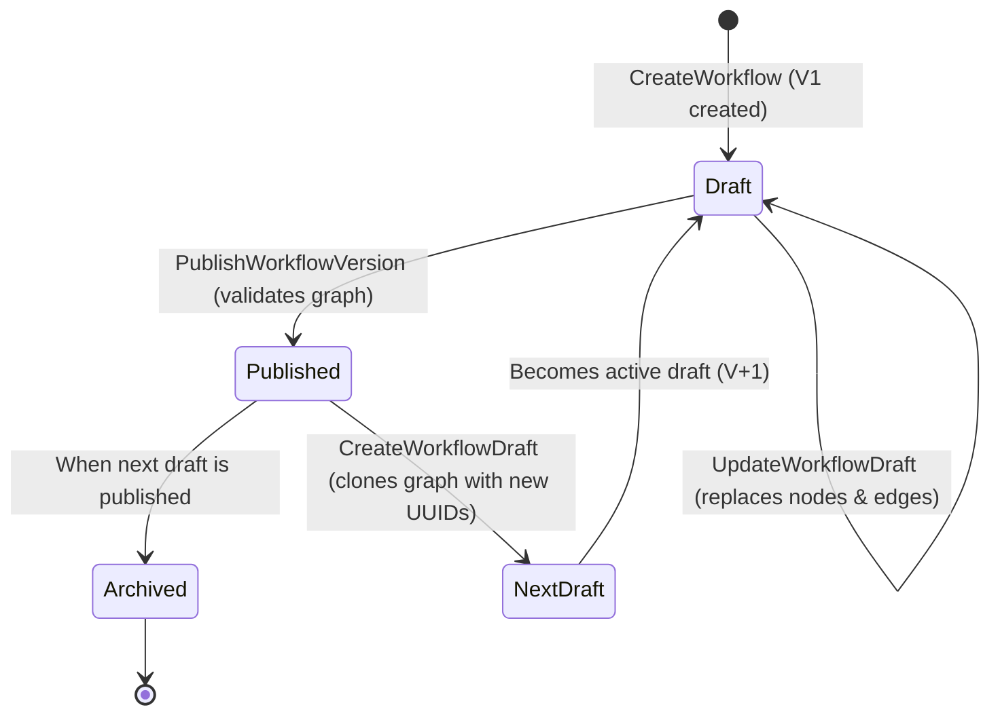

# ADR-0003: Workflow Versioning Architecture

**Status:** Accepted  
**Date:** November 2026  
**Deciders:** Project Engineering Team  
**Consulted:** `docs/internal/architecture.md`, `docs/internal/current-state.md`, `docs/internal/linear-execution-spec.md`, `docs/internal/implementation-roadmap.md`, `docs/decisions/0001-modular-monolith.md`, `docs/decisions/0002-workspace-multi-tenancy.md`  

---

## 1. Context and Problem

Workflow automation platforms require an architectural mechanism to decouple ongoing visual workflow authoring from live operational execution.

If workflows were edited in place without versioning:
1. An in-progress canvas edit would directly mutate active business logic, potentially breaking running executions or altering behavior before the graph has been structurally validated.
2. Production executions would lack determinism and historical auditability, making it impossible to determine which node configurations were active when an execution completed months prior.
3. Users would be unable to test or stage new workflow configurations without disrupting existing production automation.

The core problem is: **How should Atlas structure workflow versioning, manage the lifecycle between drafts and published definitions, guarantee operational execution stability, and serialize concurrent edits and publishing operations?**

---

## 2. Decision

Atlas adopts a **Snapshot Versioning Model** with explicit version lifecycle states and execution version pinning.

### 2.1 The Entities and Status Boundaries
- **Workflow Entity (`workflows` table):** The parent container belonging to a workspace (`workspace_id`, `name`, `slug`, `description`). The `Workflow` model acts as an organizational and routing entity; **it does not store a lifecycle status column**.
- **Workflow Version Entity (`workflow_versions` table):** Represents a distinct, versioned snapshot of the workflow graph (`workflow_id`, `version_number`, `status`, `published_at`).
- **Version Lifecycle Statuses (`App\Enums\WorkflowVersionStatus`):**
  - **`draft`**: The active editable working copy.
  - **`published`**: The validated, immutable operational snapshot active for execution.
  - **`archived`**: A historical published snapshot that has been superseded by a newer publication.

### 2.2 Core Versioning Invariants
1. **At Most One Draft Version:** A workflow may have at most one version in `draft` status at any given time.
2. **At Most One Published Version:** A workflow may have at most one version in `published` status at any given time.
3. **Zero or More Archived Versions:** A workflow may maintain zero or more historical versions in `archived` status.
4. **Draft Mutation Only:** Only versions in `draft` status are editable. Published and archived versions are intended to be strictly immutable.
5. **Publishing Lifecycle:** Publishing a draft validates the graph (via `ValidateWorkflowGraph`), archives the current published version (`status = 'archived'`), transitions the draft to `published`, and records `published_at = now()`.
6. **Draft Forking / Cloning:** When a user wishes to modify a published workflow, a new draft ($N+1$) is created via `CreateWorkflowDraft`. All nodes and edges from the published version are cloned into the new draft with freshly generated UUID keys (`Str::uuid()`), ensuring that the draft is completely decoupled from the published snapshot.
7. **Execution Version Pinning (Milestone M2/M3 Target):** When execution persistence is introduced in Milestone M2/M3, executions (`workflow_executions` table) will explicitly record and pin `workflow_version_id`. In alignment with the approved MVP cascade deletion policy, foreign keys enforce `ON DELETE CASCADE` so deleting a workflow or workspace cleanly purges associated executions; soft deletion and audit retention are deferred to Milestone M6. The execution engine resolves nodes and edges exclusively from that pinned snapshot. Ongoing draft editing or subsequent version publications have zero impact on in-flight or completed runs. *(Note: The execution schema and runtime engine do not exist in the current baseline.)*
8. **Parent Workflow Row-Locking:** All version-modifying operations (`CreateWorkflowDraft`, `UpdateWorkflowDraft`, `PublishWorkflowVersion`, and future execution initiation) must serialize against the **parent `Workflow` row** using `lockForUpdate()` within an atomic database transaction.

---

## 3. Rationale

### 3.1 Strict Separation of Authoring and Execution
By isolating draft nodes and edges in dedicated version rows, developers and business users can iteratively experiment, save canvas states, and rearrange nodes without risking operational disruption. Production executions continue running against the immutable published version.

### 3.2 Native Database Constraint Enforcement
PostgreSQL partial unique indexes natively enforce the single-draft and single-published invariants at the database level:
- `CREATE UNIQUE INDEX workflow_versions_one_draft_per_workflow ON workflow_versions (workflow_id) WHERE status = 'draft';`
- `CREATE UNIQUE INDEX workflow_versions_one_published_per_workflow ON workflow_versions (workflow_id) WHERE status = 'published';`
This guarantees that race conditions cannot produce duplicate drafts or multiple concurrently active published versions, even under concurrent requests.

### 3.3 Clean Graph Decoupling via UUID Remapping
When a draft is forked from a published version, `CreateWorkflowDraft` generates brand new UUIDs for every cloned node and updates edge source/target references. This eliminates shared-reference hazards: deleting or updating a node in a draft has zero relational or cascade impact on the published snapshot.

### 3.4 Regulatory Compliance and Audit Durability
In enterprise automation, historical auditability is non-negotiable. In the target execution architecture (Milestones M2/M3), pinning execution records to `workflow_version_id` guarantees that inspecting a six-month-old execution record reproduces the exact node configurations, step order, and logic that executed at that timestamp.

---

## 4. Alternatives Considered

### Alternative 1: Mutable In-Place Editing (No Versioning)
- **Description:** Storing nodes and edges directly against the `Workflow` model and updating them in place whenever a user saves the canvas.
- **Why Rejected:**
  - Destroys execution determinism and stability: saving a work-in-progress draft could immediately break or alter an active execution mid-flow.
  - Lacks change auditing: impossible to determine what changed between revisions or roll back to a known working state.

### Alternative 2: Event-Sourced / Git-Style Commit Graph
- **Description:** Storing graph changes as a sequence of event deltas or a directed acyclic commit tree.
- **Why Rejected:**
  - Immense architectural complexity: loading the canvas or executing a workflow would require replaying hundreds of delta events to materialize the current graph.
  - Premature engineering: workflow graphs in Atlas are small ($\approx 5-50$ nodes), making snapshot cloning far simpler, more reliable, and easily queryable using standard relational SQL.

### Alternative 3: Linear State Machine on the Workflow Model
- **Description:** Storing `status` directly on the `workflows` table (`draft`, `published`, `archived`).
- **Why Rejected:**
  - A workflow cannot be both active in production and simultaneously have a new draft being edited. Users would be forced to take the workflow "offline" or create an entirely separate workflow to make updates.

---

## 5. Consequences and Limitations

### 5.1 Positive Consequences
- **Zero Execution Contention:** Active executions run with zero interference from ongoing visual drafting.
- **ACID State Transitions:** Publishing a draft and archiving the predecessor occur atomically within a single database transaction.
- **Auditable Execution Pinning:** Historical execution records remain permanently linked to their exact version definitions.
- **Deterministic Replay:** Cloned versions are completely isolated and self-contained.

### 5.2 Negative Consequences & Known Limitations
- **Storage Duplication:** Cloning nodes and edges on draft creation duplicates graph records in PostgreSQL. However, given typical workflow graph sizes, the storage cost is negligible compared to the architectural simplicity gained.
- **Draft Save Replacement:** `UpdateWorkflowDraft` currently replaces the entire set of nodes and edges for the draft within a transaction. While simple, this requires the client to submit the full graph topology on every save.
- **Strict Linear Sequencing:** A workflow cannot support multiple simultaneous drafts authored by different team members; collaboration on drafts must be serialized.

---

## 6. Current Implementation Status

This section explicitly documents the verified state of implementation versus intended guarantees:

| Versioning Invariant | Enforcement Mechanism | Implementation Status |
|---|---|---|
| **At most one draft per workflow** | PostgreSQL partial unique index `workflow_versions_one_draft_per_workflow` | **Enforced in Database** |
| **At most one published version per workflow** | PostgreSQL partial unique index `workflow_versions_one_published_per_workflow` | **Enforced in Database** |
| **Unique version number per workflow** | PostgreSQL composite unique index `(['workflow_id', 'version_number'])` | **Enforced in Database** |
| **Archiving predecessor upon publishing** | Application logic in `PublishWorkflowVersion` (inside transaction) | **Enforced in Action** |
| **Draft updates restricted to draft status** | In-memory status check in `UpdateWorkflowDraft` | **Partially Enforced in Action** *(Throws unhandled `\LogicException`, lacks row-locking, does not re-fetch from DB)* |
| **Parent workflow row locking** | Pessimistic `lockForUpdate()` on parent `Workflow` row | **Inconsistent** *(Enforced in `PublishWorkflowVersion` and `CreateWorkflowDraft`; missing in `UpdateWorkflowDraft`)* |
| **Published & archived version immutability** | Frontend disabled state (`isEditable = false`) & Action status check | **UI-Only / Partial Action Protection** *(Database and models do not prevent mutation; complete guards scheduled for Milestone M1)* |
| **Execution version pinning** | Foreign key `workflow_executions(workflow_version_id)` with `CASCADE` | **Planned for Milestone M2/M3** *(Execution schema does not exist in baseline; soft delete deferred to M6)* |

### 6.1 The Concurrency Race Vulnerability
In the current baseline:
- `PublishWorkflowVersion` acquires a pessimistic row lock on the parent workflow (`Workflow::query()->whereKey($version->workflow_id)->lockForUpdate()->firstOrFail()`) and on the draft version (`$workflow->versions()->whereKey($version->id)->lockForUpdate()->firstOrFail()`) inside a transaction before publishing.
- `CreateWorkflowDraft` acquires an identical row lock on the parent workflow (`Workflow::query()->whereKey($workflow->id)->lockForUpdate()->firstOrFail()`) inside a transaction before creating a draft.
- **The Gap:** `UpdateWorkflowDraft` executes within a database transaction, but **does not acquire a lock on the parent `Workflow` row** (or the draft version row), and checks `$version->status` solely against the in-memory model instance without refreshing from the database under lock.
- **The Failure Mode:** If a user submits a draft update concurrently with another user publishing that draft, the draft update can interleave with publication, potentially overwriting nodes and edges of a version that was just marked `published`. Furthermore, if `UpdateWorkflowDraft` encounters a non-draft status, it throws an unhandled raw `\LogicException`, producing an unexpected HTTP 500 error.
- **Approved Remediation (Milestone M1):** In exact alignment with `docs/internal/implementation-roadmap.md` §4.4.2, `UpdateWorkflowDraft` must acquire the exact same pessimistic lock on the parent `Workflow` row (`Workflow::query()->whereKey($version->workflow_id)->lockForUpdate()->firstOrFail()`) within its transaction, refresh and re-check the draft version status under that lock, and throw a clean `ValidationException` (HTTP 422) instead of a raw `\LogicException` (HTTP 500) if the version is no longer a draft.

### 6.2 Immutability Enforcement Status
In the current baseline, non-draft (published and archived) versions are protected only by the frontend canvas disabling edit controls (`isEditable = false` in `resources/js/pages/workflows/show.tsx`) and the incomplete application-level status check in `UpdateWorkflowDraft`. The database and Eloquent models do not prevent direct inserts, updates, or deletions of `workflow_nodes` or `workflow_edges` belonging to published or archived versions.

In exact alignment with `docs/internal/implementation-roadmap.md` §4.4.3, complete immutability enforcement is scheduled for **Milestone M1: Workflow Definition & Version Integrity** across three explicit scopes:
1. **Version Metadata:** Prohibit updating attributes (`version_number`, `published_at`, `status`) of a version once published or archived, except for the explicit transition `published -> archived` during publication of a new version.
2. **Workflow Nodes:** Prohibit creating, updating, or deleting `workflow_nodes` belonging to published or archived versions.
3. **Workflow Edges:** Prohibit creating, updating, or deleting `workflow_edges` belonging to published or archived versions.

Enforcement will be implemented through model-level constraints and action guards, backed by feature tests confirming direct mutation attempts against non-draft versions fail.

### 6.3 Execution Version Pinning Status
In the current baseline, execution tables (`workflow_executions` and `workflow_execution_steps`) do not exist. As defined in `docs/internal/implementation-roadmap.md` §5 (Milestone M2) and §6 (Milestone M3), execution version pinning is future functionality:
- Milestone M2 will create the database schema including `workflow_executions.workflow_version_id` with `ON DELETE CASCADE` in alignment with the MVP cascade deletion policy (soft deletion and audit retention are deferred to Milestone M6).
- Milestone M3 will implement the execution runtime engine, ensuring that running executions resolve their nodes and edges exclusively from that pinned snapshot without being affected by concurrent draft authoring or subsequent version publications.

---

## 7. Future Reconsideration Conditions

This versioning architecture is authoritative for Milestones M0–M4 and the initial execution engine rollout. The decision may be reconsidered or extended if the following operational needs arise:

1. **Concurrent Multi-Draft Collaboration:** If enterprise team requirements demand multiple simultaneous named drafts (e.g. staging branches authored by separate team members), the single-draft partial unique index would need to be relaxed in favor of a branch/draft naming discriminator.
2. **Dynamic Execution Migration:** If long-running asynchronous workflows (Milestones M5+) require hot-patching in-flight executions from an older published version to a newer bug-fix version, an explicit migration orchestration subsystem would need to be designed.
3. **Delta-Based Node Storage:** If workflow graphs scale to thousands of nodes per workflow, snapshot cloning could be augmented with delta-based structural storage to reduce row duplication.
