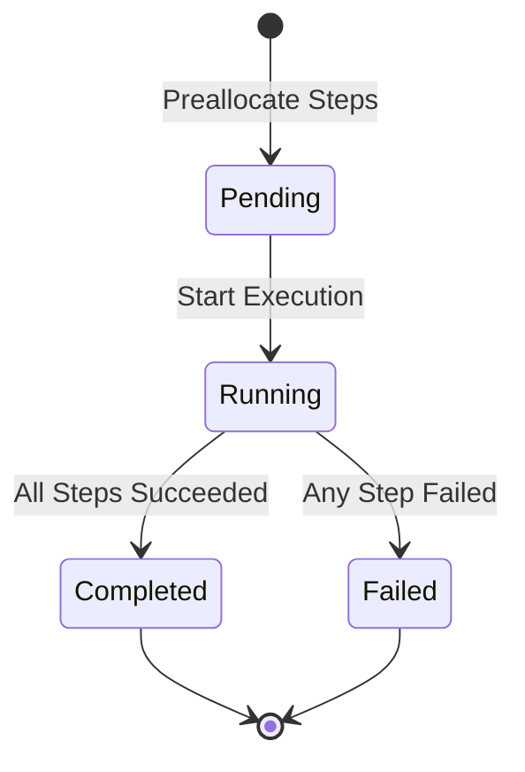

# ADR-0004: Workflow Execution Model

**Status:** Accepted  
**Date:** November 2026  
**Deciders:** Project Engineering Team  
**Consulted:** `docs/internal/architecture.md`, `docs/internal/linear-execution-spec.md`, `docs/internal/implementation-roadmap.md`, `docs/internal/current-state.md`, `docs/decisions/0001-modular-monolith.md`, `docs/decisions/0002-workspace-multi-tenancy.md`, `docs/decisions/0003-workflow-versioning.md`  

---

## 1. Context and Problem

Atlas requires a workflow execution engine to run automated processes defined visually in the workflow canvas.

In designing the initial execution engine, several fundamental architectural challenges must be resolved:
1. **Scope and Topology Complexity:** Workflow engines frequently succumb to premature complexity by attempting to support arbitrary directed acyclic graphs (DAGs), conditional branching, fan-out/fan-in concurrency, loops, dynamic retries, and distributed queue orchestration before establishing a solid, deterministic core.
2. **Execution Determinism & Auditability:** Executions must be deterministic, traceable, and inspectable. If a workflow fails midway, operators must know exactly which node failed, what input it received, what error occurred, and have durable access to all preceding successful step outputs.
3. **Concurrency and Data Integrity:** Executions must run against an immutable, validated snapshot of a workflow definition without being corrupted by concurrent authoring edits or publishing operations.
4. **Data Propagation:** Intermediate steps need a predictable contract to access both the output of the immediate predecessor and cumulative outputs from earlier steps in the flow.
5. **Idempotency and Duplicate Execution:** External clients and webhooks trigger executions under unreliable network conditions where retried requests must not generate duplicate operational runs.

The core problem is: **What execution model, topological constraints, persistence boundaries, data propagation rules, and failure semantics should govern the initial workflow execution engine in Atlas?**

---

## 2. Decision

Atlas adopts a **Strictly Linear, Synchronous, In-Process Execution Model** for its initial execution engine (Milestones M2–M4).

### 2.1 Initial Topological Contract
The workflow execution engine strictly enforces an unbranched linear pipeline:
$$\text{Trigger} \longrightarrow \text{zero or more Actions} \longrightarrow \text{End}$$

- **Nodes ($V$):** Exactly one Trigger ($v_{\text{trigger}}$) and exactly one End ($v_{\text{end}}$), with zero or more intermediate Action nodes ($v_{\text{action}_1}, \dots, v_{\text{action}_n}$).
  $$|V| = n + 2 \ge 2 \quad (n \ge 0)$$
- **Degree Constraints:**
  - $v_{\text{trigger}}$: in-degree = 0, out-degree = 1.
  - Each $v_{\text{action}_i}$: in-degree = 1, out-degree = 1.
  - $v_{\text{end}}$: in-degree = 1, out-degree = 0.
- **Edges ($E$):** Exactly $|E| = |V| - 1$ edges connecting adjacent nodes in sequence.
- **Direct Trigger-to-End:** A workflow with zero actions ($|V| = 2, |E| = 1$) is explicitly legal and supported.
- **No Non-Linear Constructs:** Branching, conditional switching, parallel paths, fan-out/fan-in joins, loops, and cycles are strictly rejected by the validator and unsupported by the engine.

### 2.2 Version Eligibility & Version Pinning
- **Published Versions Only:** An execution can only be initiated against a workflow version with `status = 'published'` (`WorkflowVersionStatus::Published`). Draft and archived versions cannot be executed.
- **Execution Version Pinning:** Every execution explicitly records and pins `workflow_version_id` at creation time. The execution engine resolves nodes and edges exclusively from this pinned snapshot.
- **Cascade Deletion Policy (MVP):** In alignment with the approved MVP deletion architecture, foreign keys from executions to workflows, workspaces, and workflow versions enforce `ON DELETE CASCADE`. Deleting a workspace or workflow automatically cascades to all associated versions, executions, and steps. Execution history is not retained upon workspace or workflow deletion in the MVP; audit retention safeguards and soft deletion are deferred to Milestone M6.
- **Workflow Row Lock on Creation:** Initiating an execution requires acquiring a pessimistic lock on the parent `Workflow` row (`lockForUpdate()`) within an atomic transaction. This serializes execution creation against version publication and guarantees that the target version is actively published at the moment the execution record is created.

### 2.3 Execution Mode
- The initial execution engine runs **synchronously and in-process** within the web request or CLI process.
- Background asynchronous processing, distributed queues (e.g. Redis, Laravel Horizon), and worker fleets are explicitly deferred to later milestones (Milestone M5).

---

## 3. Execution Lifecycle and Data Model

### 3.1 Data Model and Relationships
The execution subsystem introduces two relational persistence tables (Milestone M2):
1. **`workflow_executions`:** Represents the overall execution instance.
   - Tenant-scoped: `workspace_id`, `workflow_id`, `workflow_version_id`.
   - Execution lifecycle: `status`, `started_at`, `finished_at`.
   - Data payload: `trigger_type`, `trigger_payload` (JSONB), `error` (TEXT or JSONB nullable).
   - Idempotency & Audit: `idempotency_key` (VARCHAR nullable), `created_by` (BIGINT nullable User ID).
2. **`workflow_execution_steps`:** Represents the execution record of an individual node in the linear sequence.
   - Scoped: `workflow_execution_id`, `workflow_version_id`, `node_key` (UUID referencing `workflow_nodes`), `step_number` (integer, 1-based sequence).
   - Node type: `node_type` (`trigger`, `action`, `end`).
   - Execution lifecycle: `status`, `attempt` (integer, fixed at 1), `started_at`, `finished_at`.
   - Data payload: `input` (JSONB nullable), `output` (JSONB nullable), `error` (TEXT or JSONB nullable).

```
[workspaces] 1 ──< [workflows] 1 ──< [workflow_versions] 1 ──< [workflow_nodes]
                          │                         ▲                      ▲
                          │                         │                      │
                          └─────── 1 ──< [workflow_executions] 1 ──< [workflow_execution_steps]
```

### 3.2 Relational Integrity & Cascade Deletion Policy
The data model enforces strict relational consistency and cascade lifecycle rules:
1. **Pinned Version Node Membership:** Every step's `node_key` must belong to the exact `workflow_version_id` pinned by its parent execution (`workflow_execution_steps.workflow_version_id == workflow_executions.workflow_version_id`).
2. **Relational Consistency:**
   - `workflows.workspace_id == workflow_executions.workspace_id`
   - `workflow_versions.workflow_id == workflow_executions.workflow_id`
3. **Cascade Deletion Behavior (MVP):** Foreign keys to `workspaces`, `workflows`, and `workflow_versions` enforce `ON DELETE CASCADE`. Deleting a workflow or workspace cascades to purge all associated versions, executions, and execution steps cleanly without PostgreSQL constraint conflicts. Execution history is not retained upon workflow or workspace deletion in the MVP. (Audit retention safeguards and soft deletion are deferred to Milestone M6).

### 3.3 Preallocation of Steps
At execution creation time, the engine computes the linear topological sort of the pinned version's nodes and **preallocates all $|V|$ execution step records** in database rows with `status = 'pending'`:
- Step 1: Trigger node (`step_number = 1`, `node_type = 'trigger'`)
- Steps $2 \dots (|V|-1)$: Action nodes in sequence (`step_number = 2 \dots (|V|-1)`, `node_type = 'action'`)
- Step $|V|$: End node (`step_number = |V|`, `node_type = 'end'`)

This guarantees complete visibility into the planned pipeline before execution begins.

### 3.4 State Machines
- **Execution Statuses (`App\Enums\WorkflowExecutionStatus`):**
  - `pending`: Created and steps preallocated; awaiting execution.
  - `running`: Engine has commenced processing steps.
  - `completed`: All $|V|$ steps succeeded; final output recorded.
  - `failed`: A step failed; execution halted immediately.
- **Step Statuses (`App\Enums\ExecutionStepStatus`):**
  - `pending`: Preallocated; waiting its turn in the sequence.
  - `running`: Currently executing.
  - `completed`: Successfully executed; output persisted.
  - `failed`: Execution failed with an unhandled exception or error.
  - `skipped`: Downstream step bypassed because an earlier step failed.



### 3.5 Discrete Per-Step Transactions
- **No Monolithic Transaction:** The entire execution must **not** run inside a single database transaction. Wrapping an execution in a monolithic transaction would roll back all step logs if a step failed, destroying the audit trail.
- **Per-Step Atomic Boundary:** Each individual step executes within its own database transaction that updates the step record (`status = 'running'` $\to$ `status = 'completed'` / `'failed'`), records inputs/outputs/errors, and commits independently. Completed step records remain durable in PostgreSQL even if downstream steps fail or the process terminates abruptly.

### 3.6 Hybrid Data Propagation Model
Data flows through the pipeline using a **Hybrid Model** providing both direct pipeline chaining and cumulative context access:
1. **Direct Input (`$input`):** The payload delivered to a step.
   - For Step 1 (Trigger): `$input` is the validated incoming `trigger_payload`.
   - For Steps $2 \dots |V|$: `$input` is the exact `output` produced by the immediately preceding step.
2. **Cumulative Context (`$context`):** A read-only cumulative dictionary passed to each step containing:
   - `trigger`: The initial trigger payload.
   - `<node-uuid>`: Keyed by each completed node's UUID (`node_key`), storing its exact output payload.
3. **Engine-Managed Nodes:**
   - **Trigger Node:** Engine-managed pass-through. Validates `trigger_payload` and outputs it as the step's `output`.
   - **End Node:** Engine-managed terminator. Receives the final action's output as `$input` and mirrors it as the execution's final `output_payload`.

### 3.7 Initial Action Registry & Determinism
The initial engine supports exactly two deterministic core actions:
1. **`action.echo`:**
   - Diagnostic and pass-through utility.
   - Emits its input payload as its output payload unmodified, or injects configured static message fields.
2. **`action.transform`:**
   - Deterministic structural reshaping and key mapping.
   - Mapping configuration format: destination field name mapped to dot-separated source path (e.g. `{"user_name": "user.profile.name"}`).
   - Missing source paths evaluate to a configured static default or are omitted from the output.
   - **Modes:**
     - `project`: Returns only fields explicitly defined in the mapping or default configuration.
     - `merge`: Performs a shallow copy of `$input`, then applies mapped and default values, overriding matching top-level keys.

**Strict Determinism Invariant:** Action handlers must produce deterministic output for identical input and configuration. Action handlers must **not** inject non-deterministic values (such as timestamps, system hostnames, or random numbers) into output payloads. (Execution-level and step-level timestamps like `started_at` are persisted strictly in dedicated relational columns, never in JSON payloads).

### 3.8 Payload Contracts & Size Limits
- Trigger payloads and all action inputs and outputs must be valid **JSON objects** (associative arrays). An empty object `{}` is valid.
- Top-level scalar values (strings, integers, booleans) and top-level JSON arrays are **rejected** with validation errors.
- Maximum payload size is enforced at **1 MB** ($1{,}048{,}576$ bytes). Payloads exceeding this limit are rejected before execution.

### 3.9 Failure Semantics & Idempotency
- **Fail-Fast Termination:** If any step fails:
  1. The failing step is marked `status = 'failed'` with its error message and stack trace persisted.
  2. The parent execution is marked `status = 'failed'`.
  3. All subsequent downstream preallocated steps are immediately transitioned to `status = 'skipped'`.
  4. Execution halts immediately without executing further nodes.
- **Single Attempt / No Retries:** Each node executes at most once (`attempt = 1`). Retries, backoff, and jitter are deferred.
- **Step Uniqueness Constraints:** Enforced at the database level:
  1. Unique step number per execution:
     `CREATE UNIQUE INDEX uq_execution_step_number ON workflow_execution_steps(workflow_execution_id, step_number);`
  2. Single node execution attempt per run:
     `CREATE UNIQUE INDEX uq_execution_node_attempt ON workflow_execution_steps(workflow_execution_id, node_key, attempt);`
     *(Preserving `attempt` in the composite uniqueness constraint ensures the database schema remains strictly compatible with future retry capabilities without altering relational invariants).*
- **Idempotency Strategy:**
  - Optional `idempotency_key` supplied by callers, scoped to `(workspace_id, workflow_id, idempotency_key)`.
  - Enforced via a PostgreSQL partial unique index:
    `CREATE UNIQUE INDEX uq_executions_idempotency ON workflow_executions (workspace_id, workflow_id, idempotency_key) WHERE idempotency_key IS NOT NULL;`
  - **First-Write-Wins:** The first request to successfully insert into `workflow_executions` proceeds with execution.
  - **Concurrent Conflict Handling:** If concurrent or duplicate requests race to insert the same idempotency key, the losing request encounters a PostgreSQL unique constraint violation (`23505`). The engine catches this violation and **queries and returns the existing execution record** instead of returning an HTTP 500 error or creating a duplicate run. Subsequent duplicate payloads are ignored. If no key is supplied (`null`), execution proceeds without deduplication.

---

## 4. Rationale

### 4.1 Why Strictly Linear First?
Complex workflow engines frequently fail during initial implementation due to the combinatorial explosion of graph topologies (deadlock detection in diamond graphs, partial join semantics, cycle guards, and dynamic fan-out). By constraining the initial engine to strictly linear pipelines ($|E| = |V| - 1$), the execution model is mathematically deterministic, trivial to reason about, and provides an unshakeable foundation for runtime persistence, testing, and telemetry.

### 4.2 Why Step Preallocation?
Preallocating all $|V|$ step rows up front provides significant operational advantages:
1. **Deterministic Visibility:** Operators and the UI can immediately display the entire progress pipeline, showing upcoming nodes as `pending` before they execute.
2. **Relational Traceability:** Step sequence numbers and node relationships are established up front with strict database foreign keys and uniqueness constraints (`uq_execution_step_number` and `uq_execution_node_attempt`).
3. **Explicit Failure Auditing:** When a pipeline fails midway, unexecuted steps are explicitly marked `skipped` rather than being ambiguously missing from the database.

### 4.3 Why Synchronous In-Process Execution Initially?
Introducing distributed queue workers (Redis, Horizon, SQS, RabbitMQ) introduces distributed failure modes: message loss, invisible worker crashes, deadlocks, delayed visibility, and operational deployment burdens. Implementing synchronous in-process execution in Milestone M3 allows 100% of the domain logic, transaction boundaries, step transitions, and data propagation to be thoroughly verified via fast, deterministic automated test suites before introducing queue workers in Milestone M5.

### 4.4 Why the Hybrid Data Model?
Pure pipeline models (Unix pipes) only pass the previous step's output, forcing developers to pass through unwanted fields across multiple intermediate steps. Pure blackboard models (global context) create naming collisions and make steps dependent on arbitrary global state. The Atlas Hybrid Model gives each action its direct `$input` while providing collision-free `$context[<node_uuid>]` access to earlier outputs when needed.

---

## 5. Alternatives Considered

### Alternative 1: General DAG Execution with Parallel Branches
- **Description:** Allow arbitrary graph branches, conditional splits, and parallel action execution from day one.
- **Why Rejected:**
  - Adds extreme complexity to execution state tracking (handling partial completions, join synchronization, race conditions in context accumulation).
  - Premature optimization before single-path execution and persistence integrity are proven in production.

### Alternative 2: Monolithic Database Transaction for Entire Execution
- **Description:** Wrapping the entire workflow run inside a single `DB::transaction(...)` that commits when the End node succeeds or rolls back if any step fails.
- **Why Rejected:**
  - In a rollback, all persisted step execution logs, input payloads, and error messages are discarded from PostgreSQL.
  - Operators would have zero forensic visibility into failed runs.
  - Long-running transactions hold database locks and exhaust connection pools.

### Alternative 3: Distributed Queue-First Architecture (Redis / Horizon)
- **Description:** Dispatching every execution and step as an asynchronous queued job.
- **Why Rejected:**
  - Greatly complicates automated testing and continuous integration (requiring Redis daemon setup, worker process management, and asynchronous polling assertions).
  - In-process execution satisfies initial requirements; queue workers can be layered on seamlessly in Milestone M5 without altering the underlying execution domain models.

### Alternative 4: In-Memory Step Execution Without Preallocation
- **Description:** Creating step records dynamically only after a step executes or keeping execution in memory until complete.
- **Why Rejected:**
  - If a PHP process crashes or is killed by OOM, all in-memory progress is lost.
  - Preallocation guarantees that execution state is relational, inspectable, and robust against mid-stream failures.

---

## 6. Consequences and Limitations

### 6.1 Positive Consequences
- **Predictable & Robust:** Strictly linear execution guarantees predictable ordering with zero deadlocks or race conditions.
- **Full Operational Auditability:** Every step input, output, duration, and error trace is durably recorded in PostgreSQL.
- **ACID Step State:** Discrete per-step transactions ensure that successful step history is never lost when downstream steps fail.
- **Idempotency by Design:** Partial unique indexes eliminate duplicate runs from webhook retries.
- **Zero External Infrastructure:** Runs directly within Laravel and PostgreSQL without requiring Redis or background worker fleets for initial milestones.

### 6.2 Negative Consequences & Known Limitations
- **No Branching or Conditional Logic:** Users cannot branch based on data values in the initial engine; all nodes in the workflow must execute linearly or fail.
- **Synchronous Request Blocking:** In-process execution blocks the HTTP request or CLI runner until the entire workflow completes. Workflows must be short-lived ($\le 30$ seconds) to avoid HTTP gateway timeouts.
- **Crash State Ambiguity:** If a PHP process terminates abruptly (e.g. fatal `SIGKILL` or power outage) while a step is executing, the execution and step will remain in `running` status. Automatic stale-run reaping is deferred to future milestones.
- **Storage Growth:** Preallocating step records and storing full JSON inputs/outputs for every run increases database storage over time, requiring retention/pruning policies in later milestones.

---

## 7. Current Implementation Status

This section explicitly documents the verified current baseline versus approved target architecture:

| Capability | Current Repository Baseline | Approved Target Architecture (ADR-0004) |
|---|---|---|
| **Graph Validation** | `ValidateWorkflowGraph` validates general DAG properties (Trigger, End, cycles, reachability) | Linear validator enforcing $|E| = |V| - 1$ and strict degree constraints **(Milestone M1)** |
| **Canvas Serialization** | Strips custom node config, saving only `{ label }` | Editor updated to serialize and persist full node configurations **(Milestone M1)** |
| **Execution Schema** | **Non-existent**; no execution tables or models exist in database | Migrations and Eloquent models for `workflow_executions` and `workflow_execution_steps` **(Milestone M2)** |
| **Step Preallocation** | **Non-existent** | Preallocation logic from linear sort **(Milestone M2)**; invoked on execution creation **(Milestone M3)** |
| **Action Registry** | **Non-existent**; no action classes exist | Core deterministic `action.echo` and `action.transform` handlers **(Milestone M3)** |
| **Execution Engine** | **Non-existent**; no execution actions or controllers exist | Synchronous, in-process linear execution runner **(Milestone M3)** |
| **Version Pinning** | Draft/published snapshots exist, but executions do not exist | Schema FK `workflow_executions(workflow_version_id)` with `CASCADE` **(Milestone M2)**; runtime resolution **(Milestone M3)** |
| **Idempotency** | **Non-existent** | Partial unique index `uq_executions_idempotency` **(Milestone M2)**; controller catch & return-existing logic **(Milestone M3)** |

---

## 8. Future Reconsideration Conditions

This execution model is authoritative for Milestones M2–M4. The decision will be revisited and extended under the following conditions:

1. **Asynchronous Background Processing (Milestone M5):** When long-running workflows, rate-limited external APIs, or high execution throughput require dispatching runs to queue workers (e.g. Redis, Laravel Horizon, or database queues).
2. **Non-Linear Topologies (Milestone M6+):** When user requirements demand conditional branching (`if/else`), switch routers, parallel execution branches, or fan-in joining.
3. **Advanced Reliability & Retries:** When transient network failures necessitate per-step automatic retry policies with exponential backoff and dead-letter queues.
4. **Stale Execution Recovery:** When long-running or distributed execution requires a heartbeat monitor or background reaper to detect and fail orphaned runs stranded in `running` state by abrupt process crashes.
5. **Rich Action Catalog:** When extending the action registry beyond deterministic data transforms to include external HTTP webhooks, SaaS connectors, and AI/LLM invocation nodes.