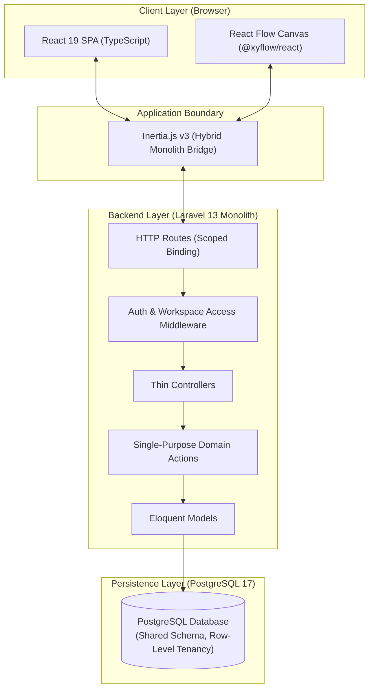
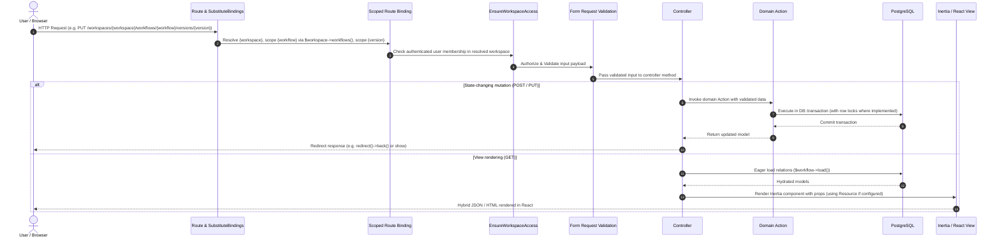
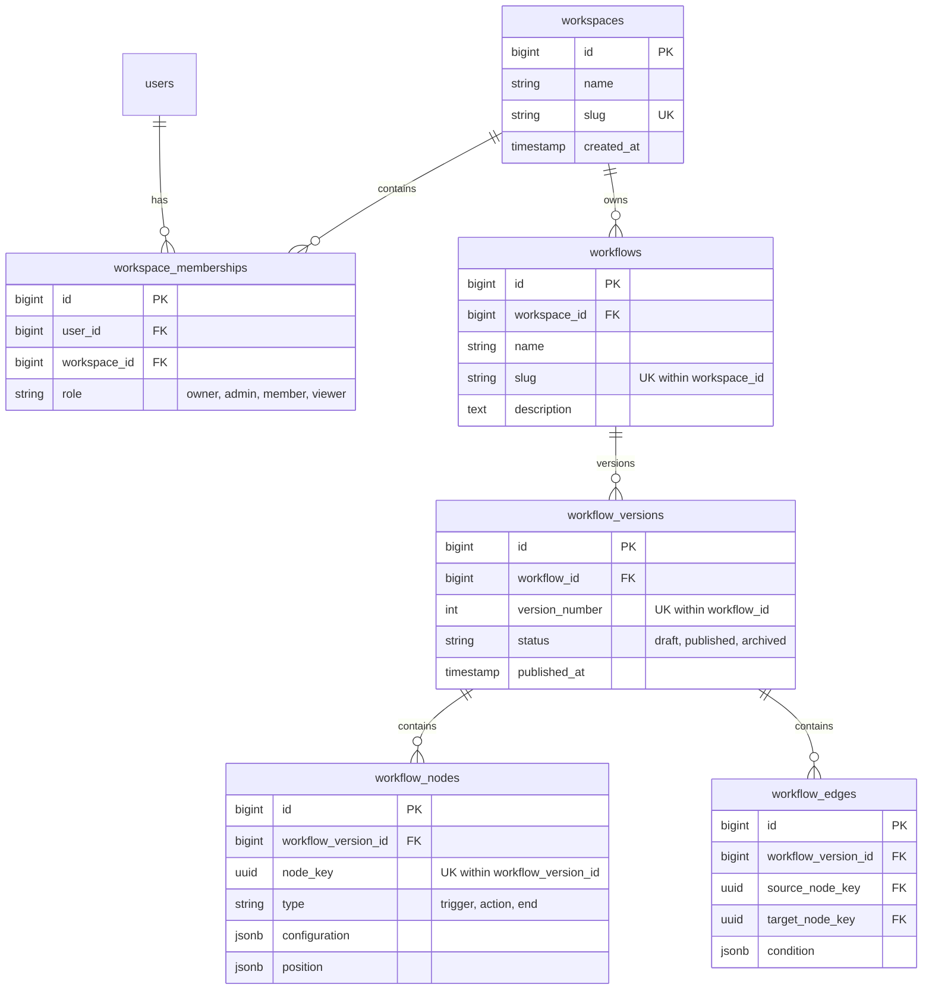
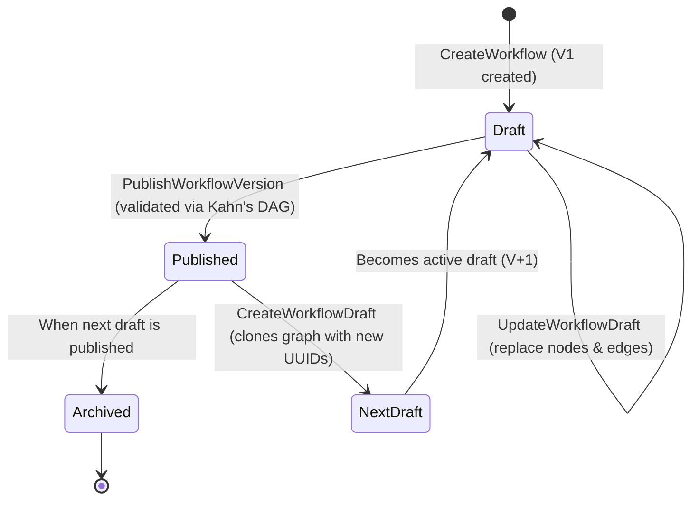
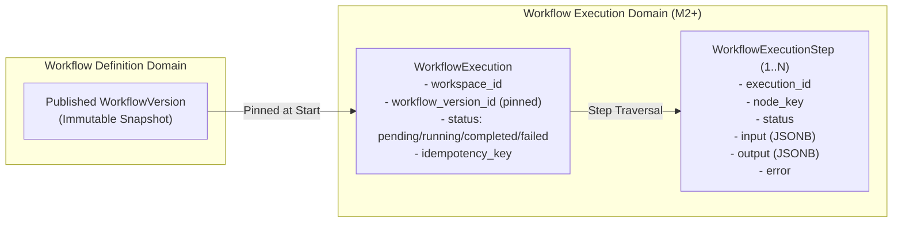

# Atlas — Technical Architecture

**Document Version:** 1.0  
**Status:** Active System Architecture  
**Baseline Reference:** `docs/internal/current-state.md` (November 2026)  
**Vision Reference:** `docs/internal/atlas-product-and-architecture.md`

---

## 1. Architecture Overview

**Atlas** is an AI-powered, multi-tenant workflow automation Software-as-a-Service (SaaS) platform designed for businesses. In its current implementation phase, Atlas provides a reliable and auditable environment where business workspaces can create workspaces, visually construct workflow graphs on an interactive canvas, and manage immutable versioned definitions (draft, published, archived).

Deterministic, step-by-step workflow execution is the core future platform capability scheduled for upcoming milestones (M2+) and is not yet implemented.

Architecturally, Atlas is structured as a **modular monolith**. It integrates a Laravel 13 backend with a React 19 single-page frontend via Inertia.js v3, persisting application and workflow graph definitions in PostgreSQL 17.



---

## 2. Technology Stack

| Layer | Technology | Version | Architectural Responsibility |
|---|---|---|---|
| **Runtime & Language** | PHP | 8.3+ | Server runtime, strongly typed domain execution. |
| **Backend Framework** | Laravel | 13.x | Routing, middleware pipeline, dependency injection, transaction management, Eloquent ORM. |
| **Authentication** | Laravel Fortify | 1.37+ | Headless authentication: registration, session login, password reset, email verification, 2FA, passkeys. |
| **Monolith Bridge** | Inertia.js | 3.x | Server-driven frontend protocol eliminating custom client-side REST/GraphQL plumbing. |
| **Frontend Runtime** | React | 19.x | Component lifecycle, declarative UI state, form management. |
| **Frontend Language** | TypeScript | 5.7+ | Static type safety, shared data contract interfaces with backend models. |
| **Workflow Canvas** | `@xyflow/react` | 12.x | Visual workflow editor: interactive node dragging, edge connections, canvas viewport controls. |
| **Styling & Components** | Tailwind CSS / Radix UI | v4 / Latest | Design token styling, accessible primitive components, Lucide icons. |
| **Database** | PostgreSQL | 17.x | Relational persistence, JSONB document storage, partial unique indexing, composite foreign keys. |
| **Development Infra** | Docker Compose | Latest | Containerized PostgreSQL 17 service (`port 5458`) for development and local testing. |

---

## 3. Architectural Style and Application Boundaries

Atlas deliberately employs a **modular monolith** rather than distributed microservices or a decoupled REST/SPA architecture. 

### Why the Modular Monolith Style Fits Atlas
1. **Transactional Integrity:** Workflow publishing and version cloning require multi-table database transactions with pessimistic row-level locks. (While draft updates currently execute inside transactions, row-level locking for draft updates is an outstanding requirement for M0). A monolithic backend allows atomic ACID transactions without distributed transaction protocols.
2. **Unified Data Model:** Tenancy boundaries and composite foreign keys are enforced directly by PostgreSQL.
3. **High Velocity via Server-Driven Monolith:** Inertia.js eliminates the overhead of managing a decoupled REST or GraphQL client API layer by passing controller data directly to React page components. Laravel Wayfinder generates TypeScript route and action helper functions, while frontend page props are strongly typed using TypeScript interfaces mirroring backend resource schemas.

### System Domain Boundaries

The application is organized into three primary domain modules, with a fourth planned:

```text
app/
├── Models/
├── Actions/
│   ├── Fortify/       ──► [Identity Domain]: User authentication, credentials, 2FA, passkeys
│   ├── Workspace/     ──► [Tenancy Domain]: Workspaces, memberships, context selection
│   └── Workflows/     ──► [Workflow Definition Domain]: Workflows, versions, nodes, edges, validation
└── (Future: Execution) ──► [Execution Domain]: Pinned runs, step runner, history tracking (M2+)
```

- **Identity Domain:** Manages user identity, credentials, two-factor authentication, and passkey registration. Independent of specific workspaces.
- **Tenancy Domain:** Establishes workspace boundaries, user memberships, and active tenant session preferences.
- **Workflow Definition Domain:** Owns workflow entity definitions, immutable version snapshots, visual graph topologies (nodes/edges), and graph validation rules.
- **Execution Domain *(Future — M2+)**:* Will own execution records, step state machines, asynchronous job queues, and execution logs.

---

## 4. Current Application Request Lifecycle

HTTP requests in Atlas traverse a layered pipeline combining framework middleware, scoped route model binding, form request validation, controllers, and domain actions:



### Verified Request Pipeline Stages:
1. **Routing & Framework Middleware:** The request matches routes in `routes/web.php`. The standard `web` middleware group runs session initialization, cookie encryption, CSRF protection, and parameter substitution (`SubstituteBindings`).
2. **Scoped Route Model Binding:** Routes declared with `->scopeBindings()` resolve child models through their declared parent Eloquent relationships (e.g., resolving `{workflow:slug}` via `$workspace->workflows()`, and `{version}` via `$workflow->versions()`). If an entity does not belong to the parent in the route hierarchy, a 404 response is returned.
3. **Workspace Access Middleware (`workspace.access`):** `EnsureWorkspaceAccess` retrieves the resolved `{workspace}` model from the route and verifies that the authenticated user has an active membership record in `workspace_memberships`. Unauthenticated or non-member users receive an HTTP 403 Forbidden response.
4. **Form Request Validation:** If type-hinted on the controller action, Form Requests (`StoreWorkflowRequest`, `UpdateWorkflowDraftRequest`) run before controller logic. They evaluate authorization (currently defaulting to `true`) and validate payload structure and types against declared rules.
5. **Controller Coordination:**
   - **For Read Requests (GET):** Controllers perform necessary model queries and eager-loading (e.g. `$workflow->load(['draftVersion.nodes', ...])`) and return an Inertia response.
   - **For State-Changing Requests (POST/PUT):** Controllers pass validated request data into single-purpose domain Actions.
6. **Domain Action Execution:** Domain Actions (`app/Actions/Workflows/`, `app/Actions/Workspace/`) encapsulate business logic and database transactions (`DB::transaction`). Pessimistic row locking (`lockForUpdate()`) is implemented in `PublishWorkflowVersion` and `CreateWorkflowDraft`, but is currently an acknowledged gap in `UpdateWorkflowDraft`.
7. **Response Delivery:** State mutations typically return HTTP redirects (e.g., redirecting to the workflow canvas), while view endpoints return Inertia page responses containing serialized model or resource properties.

---

## 5. Backend Organization and Responsibilities

Atlas enforces a strict separation of concerns across backend architectural layers:

```text
Backend Layer Structure
├── Controllers   ──► HTTP transport layer: accepts requests, calls actions, returns responses
├── Middleware    ──► Boundary guards: authentication, workspace membership checks
├── Form Requests ──► Validation & input filtering: rules, payloads, structural constraints
├── Actions       ──► Core domain logic: single-purpose operations, transactions, locks
├── Models        ──► Data persistence: Eloquent schemas, relationships, attribute casting
├── Resources     ──► Presentation boundary: data contracts shaped specifically for the UI
└── Policies      ──► Authorization logic: role-based permission rules (to be expanded in M1)
```

- **Controllers (`app/Http/Controllers/`):** Coordinate HTTP request and response flows. In the current implementation, controllers handle HTTP parameters and perform direct read queries or relationship eager-loading for Inertia views (e.g., `$workflow->load(...)`, `$workspace->workflows()->get()`), while delegating state-changing mutations and multi-table transactions to Action classes. As an architectural convention, heavy query logic should be kept minimal in controllers and eventually isolated into dedicated query or repository classes.
- **Actions (`app/Actions/`):** Encapsulate discrete domain operations. By convention, Atlas domain actions in `app/Actions/Workflows/` and `app/Actions/Workspace/` expose a single public `execute()` method and manage transactional consistency (`DB::transaction`). Framework-integrated actions (such as Fortify's `CreateNewUser` and `ResetUserPassword`) implement framework contracts (`create()`, `reset()`).
- **Models (`app/Models/`):** Define database schema mappings, relationship associations (`belongsTo`, `hasMany`), attribute casting (e.g. Enums, JSON arrays, timestamps), and Eloquent factories. State mutations are orchestrated through Actions rather than heavy model lifecycle events or implicit mutators.

---

## 6. Frontend Architecture

The frontend is an Inertia.js-driven React 19 application utilizing TypeScript for strict compile-time safety.

### 6.1 State Management & Canvas Interaction
The workflow builder page (`resources/js/pages/workflows/show.tsx`) acts as the state coordinator for the visual graph editor:

- **React Flow Integration:** Uses `@xyflow/react` to render workflow graphs on an interactive SVG/HTML5 canvas.
- **Canvas State Machine:**
  - Maintains `nodes` and `edges` in React state.
  - Intercepts connection, position, and deletion events (`onNodesChange`, `onEdgesChange`, `onConnect`, `onNodesDelete`).
  - Implements dirty-state tracking by serializing the graph and comparing `currentSnapshot` against `savedSnapshot`.
- **Custom Node Components (`resources/js/components/workflow/`):**
  - `TriggerNode`: Visual root node; exposes only a **source** handle (outgoing).
  - `ActionNode`: Intermediate step; exposes a **target** handle (incoming) and a **source** handle (outgoing).
  - `EndNode`: Terminal step; exposes only a **target** handle (incoming).
- **Read-Only Historical Views:** When viewing a published or archived version (`WorkflowController::showVersion`), `isEditable` is set to `false`, disabling canvas dragging, deletion, and connections.

---

## 7. Database Architecture and Data Ownership

Data in Atlas is organized hierarchically, rooted in workspaces:



### Database Constraints and Invariants
1. **Workspace Slug Uniqueness:** `workspaces.slug` is globally unique.
2. **Tenant-Scoped Workflow Slug:** `workflows.slug` is unique strictly within `workspace_id` (`unique(['workspace_id', 'slug'])`).
3. **Version Numbering:** `workflow_versions.version_number` is unique strictly within `workflow_id`.
4. **Single Active Draft Invariant:** Enforced by PostgreSQL partial unique index:
   ```sql
   CREATE UNIQUE INDEX workflow_versions_one_draft_per_workflow
   ON workflow_versions (workflow_id) WHERE status = 'draft';
   ```
5. **Single Published Version Invariant:** Enforced by PostgreSQL partial unique index:
   ```sql
   CREATE UNIQUE INDEX workflow_versions_one_published_per_workflow
   ON workflow_versions (workflow_id) WHERE status = 'published';
   ```
6. **Composite Foreign Keys on Edges:** `workflow_edges` references `workflow_nodes` using a composite key `(workflow_version_id, node_key)` with `ON DELETE CASCADE`, ensuring an edge can never link nodes across different versions.

---

## 8. Workspace Multi-Tenancy and Isolation

Atlas implements **shared-database, shared-schema, row-level multi-tenancy**.

```mermaid
flowchart TD
    subgraph Storage ["PostgreSQL 17 Database"]
        subgraph TenantA ["Workspace A (Tenant 1)"]
            W1["Workflow A"] --> V1["Versions / Nodes / Edges"]
        end
        subgraph TenantB ["Workspace B (Tenant 2)"]
            W2["Workflow B"] --> V2["Versions / Nodes / Edges"]
        end
    end

    UserA["User A (Member of Tenant 1)"] -->|Authenticated Session| Boundary["EnsureWorkspaceAccess & Scoped Binding"]
    Boundary --> TenantA
    Boundary -.->|Access Denied (403)| TenantB
```

### Tenancy Principles in Atlas:
- **Tenant-Owned Database Tables:** In the PostgreSQL schema, `workspaces` is the root tenant model. Direct tenant ownership is represented by a non-nullable `workspace_id` column on root tenant tables: `workspace_memberships` and `workflows`. Child entities (`workflow_versions`, `workflow_nodes`, `workflow_edges`) do not store a `workspace_id` column; they inherit tenant scoping hierarchically through parent foreign keys (`workflow_id`, `workflow_version_id`).
- **No Client-Supplied Tenant IDs:** Controllers and actions do not read or trust a `workspace_id` submitted in request bodies or query parameters. The workspace context is derived from the URL route parameter verified by `EnsureWorkspaceAccess`.
- **Relational Route Model Scoping:** Laravel's `->scopeBindings()` scopes nested route resources through their declared Eloquent parent relationships (e.g. resolving `{workflow:slug}` via `$workspace->workflows()` and `{version}` via `$workflow->versions()`). Rather than performing an ad-hoc direct `workspace_id` query across every child table, it guarantees tenant boundary integrity by enforcing that each child model belongs strictly to the resolved parent in the route hierarchy.

---

## 9. Workflow and Versioning Architecture

Workflows in Atlas follow a **snapshot versioning model** designed to decouple ongoing drafting from published definitions.

In the current implementation:
- A workflow maintains at most one `draft` version and at most one `published` version, enforced by PostgreSQL partial unique indexes (`workflow_versions_one_draft_per_workflow` and `workflow_versions_one_published_per_workflow`).
- Publishing a draft marks the previous published version as `archived`.
- The frontend canvas renders published and archived versions in read-only mode by setting `isEditable = false`.

**Immutability Enforcement Status:** Complete published-version immutability is **not yet established**. While the UI prevents canvas editing for non-drafts and `UpdateWorkflowDraft` contains an application-level status check, the system currently lacks row-level locking during draft updates and has no database-level constraints or triggers preventing direct mutation of non-draft nodes and edges. Establishing complete immutability is an open architectural task for Milestone M1.

**Future Execution Pinning:** When the execution engine is introduced in M2+, workflow executions will pin an exact published `workflow_version_id` at start time. This is an intended future guarantee to ensure active executions are isolated from subsequent workflow publications or drafting changes.



### Version Lifecycle State Machine
1. **Creation:** Creating a workflow creates `Workflow` and Version 1 with `status = 'draft'`.
2. **Draft Editing:** While in `draft` status, the user may edit nodes and edges arbitrarily. Saving a draft replaces the node and edge sets inside a single transaction.
3. **Publishing:** 
   - `PublishWorkflowVersion` acquires row locks on the workflow and version.
   - Runs `ValidateWorkflowGraph` to ensure structural validity.
   - Archives the existing published version (`status = 'archived'`).
   - Marks the target draft as `published` and sets `published_at = now()`.
4. **Draft Forking / Cloning:**
   - When a user needs to modify a published workflow, `CreateWorkflowDraft` clones all nodes and edges from the published version.
   - New UUID keys are generated for every cloned node, edge references are remapped, and a new Version ($N+1$) is created with `status = 'draft'`.

---

## 10. Authorization and Security Boundaries

### Implemented Authentication
Authentication is handled by Laravel Fortify with session cookies:
- Password authentication with bcrypt hashing.
- Two-factor authentication (TOTP) with encrypted recovery codes.
- WebAuthn passkey authentication (`PasskeyUser`).
- Email verification and throttling protection on sensitive endpoints.

### Workspace Access Boundary
- Handled by `EnsureWorkspaceAccess` middleware.
- Verifies that the authenticated `user_id` has an active row in `workspace_memberships` for the target `workspace_id`.
- Rejects unauthorized requests with HTTP 403.

### Workspace Role Hierarchy & Authorization Status
The database stores four roles defined in `App\Enums\WorkspaceRole` on `workspace_memberships`:
1. `owner`: Workspace creator; intended for full administrative, member management, and billing control.
2. `admin`: Administrative access; intended to manage team members and publish workflows.
3. `member`: Creator access; intended to build and edit drafts and initiate workflow executions.
4. `viewer`: Read-only access; intended to inspect workflows and view execution history.

**Current Authorization Enforcement Status:**
- **Membership Boundary (Enforced):** The `EnsureWorkspaceAccess` middleware reliably enforces tenant boundaries by verifying that the authenticated user has an active membership record in the target workspace, aborting with HTTP 403 for non-members.
- **Role Permissions (Unenforced):** Role-based differences are **not** currently enforced in application code. Form Requests return `authorize(): bool { return true; }`, and no `WorkflowPolicy` exists. Any workspace member—including a `viewer`—can currently create workflows, edit drafts, and publish versions. Enforcing granular role permissions through a `WorkflowPolicy` is a primary requirement of Milestone M1.

---

## 11. Validation, Error Handling and Transactions

Atlas implements two distinct levels of validation:

### 11.1 Structural Request Validation (`UpdateWorkflowDraftRequest`)
- Validates that `nodes` is a non-empty array.
- Ensures all node keys are valid UUIDs and types match `trigger`, `action`, or `end`.
- Validates that `position.x` and `position.y` are numeric coordinates.
- Validates that edge `source_node_key` and `target_node_key` refer to nodes present in the submitted payload.

### 11.2 Topological Graph Validation (`ValidateWorkflowGraph`)
Executed before publishing can succeed:
1. **Single Entry / Single Exit:** Ensures exactly 1 `trigger` node and exactly 1 `end` node.
2. **Self-Loop Check:** Ensures no edge connects a node to itself ($source \ne target$).
3. **Cycle Detection (Acyclicity):** Implements **Kahn's Algorithm** (topological sort via in-degree queues). If the number of processed nodes does not equal total nodes, the graph contains a cycle and is rejected.
4. **Bidirectional Reachability:**
   - Forward Breadth-First Search (BFS) from Trigger: verifies every node can be reached from the Trigger.
   - Reverse Breadth-First Search (BFS) from End: verifies every node has a directed path leading to the End node.

### 11.3 Transactional Boundaries and Concurrency Control
- **Database Transactions:** All multi-table state mutations in domain Actions are wrapped in atomic database transactions (`DB::transaction`).
- **Pessimistic Locking Implementation:** `PublishWorkflowVersion` and `CreateWorkflowDraft` acquire row-level locks (`lockForUpdate()`) on parent workflows and draft versions to serialize state transitions.
- **Identified Concurrency Gap:** `UpdateWorkflowDraft` currently executes within a transaction but does not lock rows with `lockForUpdate()`, and throws an unhandled `\LogicException` (HTTP 500) rather than a `ValidationException` (HTTP 422) if the status changes. Rectifying this is an M1 requirement.

---

## 12. Testing and Quality Architecture

Atlas relies on automated testing against real infrastructure rather than in-memory mocks:

- **Isolated Test Database:** Tests run against a dedicated PostgreSQL database (`atlas_test`) mapped via Docker on port `5458`.
- **Database Reset Strategy:** Uses Laravel's `RefreshDatabase` trait to run migrations and rollback transactions per test.
- **Feature Tests (`tests/Feature/`):**
  - `Workflows/`: Workflow CRUD, versioning, draft cloning, publishing actions, and Inertia rendering.
  - `Workspace/`: Tenancy boundaries, membership assignment, session switching.
  - `WorkflowNodeEdge/`: Database composite foreign key constraints and node cascade deletions.
  - `Auth/` & `Settings/`: Fortify registration, login, 2FA challenges, security settings.
- **Quality Gate Suite:** Composed of 8 formal checks executed via Composer and npm scripts (`php artisan test`, `phpstan analyse`, `pint`, `tsc --noEmit`, `eslint`, `prettier`, `npm run build`, and GitHub Actions CI).

---

## 13. Current Architectural Limitations

The following architectural limitations exist in the current implementation baseline and are scheduled for remediation in upcoming milestones:

1. **Unenforced Roles:** Roles are stored in `workspace_memberships`, but no `WorkflowPolicy` exists; any member (including `viewer`) can mutate workflows. *(Addressed in M1)*.
2. **Draft Update Concurrency Race:** `UpdateWorkflowDraft` lacks row-level locking (`lockForUpdate()`), creating a race condition where concurrent draft updates can overwrite a version during publication. *(Addressed in M1)*.
3. **Incomplete Immutability Enforcement:** Immutability for published/archived versions is enforced only at application level. A formal enforcement mechanism must be established before execution begins. *(Addressed in M1)*.
4. **Lossy Node Configuration Serialization:** The React Flow canvas strips custom configuration on save, preserving only `{ label }`. *(Addressed in M1)*.
5. **Validator Allows Non-Linear Topologies:** `ValidateWorkflowGraph` checks for a connected DAG, but allows branching, diamonds, and parallel paths. It does not enforce linear degree constraints. *(Addressed in M1)*.
6. **Workspace Slug Collisions:** `CreateWorkspace` uses raw `Str::slug($name)` without collision handling. *(Addressed in M1)*.

---

## 14. Agreed Future Architecture: Workflow Execution Engine

The next major architectural domain to be introduced is the **Workflow Execution Engine** (Milestones M2+).



### Core Execution Invariants (Agreed Target)
1. **Strictly Linear Workflows Only:** The initial execution engine will support **only linear graph topologies**:
   $$\text{Trigger} \longrightarrow \text{zero or more Actions} \longrightarrow \text{End}$$
   Branching, conditions, loops, parallel branches, AI/OCR nodes, and human approval steps are **explicitly deferred** to subsequent milestones.
2. **Published Version Pinning (Intended Invariant):** At execution inception, the engine will pin an exact, published `workflow_version_id`. Subsequent draft updates or publications will have zero effect on active or completed runs.
3. **Durable Step Persistence (Intended Invariant):** Every node executed will produce a persistent `workflow_execution_steps` record storing exact inputs, outputs, timestamps, and error traces.
4. **Guarded State Machine & Terminal Immutability (Intended Invariants):** Executions and steps will transition through deterministic states (`pending`, `running`, `completed`, `failed` for executions; `pending`, `running`, `completed`, `failed`, `skipped` for steps; runtime cancellation is deferred). Terminal-state immutability (guaranteeing that completed or failed executions cannot be re-entered or altered) is an intended design invariant, pending implementation in M2–M4 and formal specification in `linear-execution-spec.md`.

*(Note: The formal execution contract, node degree rules, and database schema are detailed in `docs/internal/linear-execution-spec.md`).*
