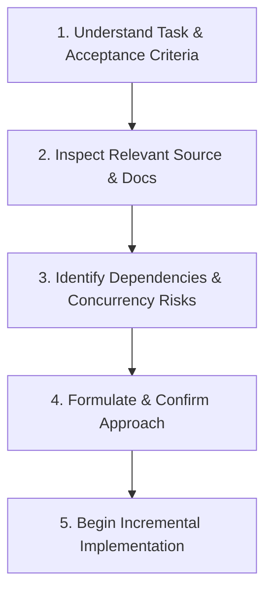
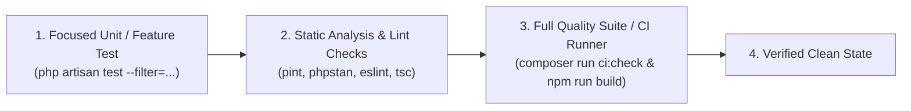
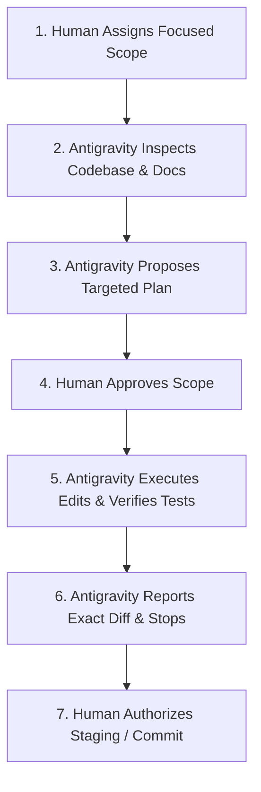

# Atlas — Development Workflow

**Document Version:** 1.0  
**Status:** Approved Engineering Standards  
**Baseline Implementation:** `docs/internal/current-state.md`  
**Architecture Reference:** `docs/internal/architecture.md`  
**Guidelines Reference:** `docs/internal/coding-guidelines.md`  
**Roadmap Reference:** `docs/internal/implementation-roadmap.md`  

---

## 1. Development Philosophy

The development workflow in Atlas is built on clarity, verification, and disciplined engineering. Because Atlas manages mission-critical business automation and versioned workflows, maintaining high system reliability is paramount.

### Core Tenets
1. **Small, Focused, Reviewable Changes:** Every task must be broken down into cohesive, incremental deliverables. Avoid combining multiple features, refactorings, or migrations into a single sweeping change.
2. **Understand Existing Behavior Before Changing It:** Never guess or assume system state. Always inspect relevant models, migrations, actions, controllers, and tests to verify actual implementation realities before proposing or writing code.
3. **Avoid Unrelated Refactoring:** Maintain strict scope discipline. When working on a task, do not reformat untouched files, update unrelated packages, or redesign working components unless explicitly authorized by the task scope.
4. **Honest and Transparent Verification:** Report quality gate results, test failures, and unresolved issues truthfully. Never bypass, silence, or ignore errors to create the illusion of completion.

---

## 2. Starting a Task

Before writing or modifying any code, follow this preparation sequence:



### 2.1 Step-by-Step Preparation
1. **Understand Task and Acceptance Criteria:** Review the task objective, referenced milestone in `implementation-roadmap.md`, and explicit exit criteria. Ensure requirements and out-of-scope boundaries are crystal clear.
2. **Inspect Relevant Files and Existing Patterns:**
   - Inspect corresponding models, controllers, actions, and form requests.
   - Review existing test coverage in `tests/Feature/` or `tests/Unit/`.
   - Check related database migrations to understand schema constraints and table relationships.
3. **Identify Dependencies and Architectural Risks:**
   - Verify whether prerequisite milestones or fixes (e.g. M0 quality gates, M1 editor configuration persistence) are required.
   - Identify potential concurrency hazards (e.g. draft editing vs. publishing races).
4. **Clarify Implementation Approach:**
   - Outline the intended changes (files to create/modify, transaction boundaries, policy gates).
   - If architectural ambiguity exists, align on open decisions before making code changes.

---

## 3. Implementation Workflow

### 3.1 Incremental Execution
Work in small, logical increments:
- Implement the core domain Action or service first.
- Add or update the Form Request and validation rules.
- Connect the thin Controller method or Inertia endpoint.
- Implement or update the frontend React/Inertia component.
- Write or update tests in lockstep with implementation.

### 3.2 Architectural Separation of Responsibilities
Maintain strict domain boundaries defined in `architecture.md` and `coding-guidelines.md`:
- **Controllers (`app/Http/Controllers/`):** Thin orchestrators only. Handle route model binding, inject Actions, and return Inertia views or redirects. Never put database transactions or complex logic in controllers.
- **Actions (`app/Actions/{Domain}/`):** Single-purpose operations exposing a public `execute()` method. Actions own database transactions (`DB::transaction`) and concurrency locks (`lockForUpdate()`).
- **Models (`app/Models/`):** Define `$fillable`, explicit relationship return types, and attribute casts via `casts(): array`. Models do not orchestrate business workflows.
- **Frontend (`resources/js/`):** Keep presentation modular. Separate UI primitives (`components/ui/`) from domain widgets (`components/workflow/`) and Inertia pages (`pages/`).

### 3.3 Continuous Diff Inspection
After each meaningful code change:
- Run `git status --short` to verify working tree cleanliness.
- Run `git diff` to review modified lines for unwanted formatting changes, leftover debug statements (`dd()`, `dump()`, `console.log`), or accidental edits.

---

## 4. Database Change Workflow

Database changes in Atlas must adhere to strict PostgreSQL standards to ensure transactional integrity and tenant isolation.

### 4.1 Migration Authoring & Review
1. **Create Migrations via Artisan:**
   ```bash
   php artisan make:migration create_workflow_executions_table
   ```
2. **Explicit Column Types & Constraints:**
   - Use `bigint` primary keys (`id()`).
   - Use `foreignId('...')` with explicit cascade constraints:
     - Root tenant tables: `cascadeOnDelete()`.
     - Execution persistence tables (MVP): `cascadeOnDelete()` (`ON DELETE CASCADE`) to support clean cascade deletion during early milestones; soft deletion is deferred to M6.
   - Use PostgreSQL-native `jsonb` for semi-structured data (configurations, payloads, step results).
   - Use `timestamp with time zone` (`timestamps()`, `published_at`, `started_at`, `finished_at`).
3. **Indexes & Uniqueness:**
   - Index all foreign key columns.
   - Use partial unique indexes where conditional uniqueness is required (e.g. one published version per workflow `WHERE status = 'published'`, unique `idempotency_key` `WHERE idempotency_key IS NOT NULL`).
4. **Reversibility Requirement:**
   - Every migration **must** implement both `up()` and `down()` methods.
   - Verify reversibility locally:
     ```bash
     php artisan migrate
     php artisan migrate:rollback
     php artisan migrate
     ```
5. **No Destructive In-Place Edits:**
   - Never modify an existing migration file that has already been committed or merged. Always write a new migration to alter tables.
   - Never drop columns or tables without explicit architectural approval.

---

## 5. Testing and Verification

Testing in Atlas relies on real PostgreSQL infrastructure (`atlas_test` on port 5458), verifying behavior across models, actions, policies, and HTTP endpoints.



### 5.1 Focused Testing First
During active development, run targeted tests for immediate feedback:
```bash
# Run a specific feature test file
php artisan test tests/Feature/Workflows/CreateWorkflowTest.php

# Filter by a specific test method
php artisan test --filter=test_workspace_member_can_create_a_workflow
```

### 5.2 Layer-Specific Static Checks
Verify the layer you touched before running full suites:
- **Backend PHP:**
  ```bash
  composer run lint:check   # Runs Pint style check
  composer run types:check  # Runs Larastan static analysis
  ```
- **Frontend TypeScript/React:**
  ```bash
  npm run types:check       # Runs tsc --noEmit
  npm run lint:check        # Runs ESLint
  npm run format:check      # Runs Prettier check
  ```

### 5.3 Full Quality Gate Verification
Before considering any task or milestone complete, contributors must run and pass the project quality suite:

```bash
# 1. Automated Comprehensive CI Suite
composer run ci:check

# 2. Production Asset Build
npm run build
```

#### How `composer run ci:check` Relates to Individual Quality Gates
In `composer.json`, the `ci:check` script orchestrates the quality checks in a single automated pipeline:
```text
composer run ci:check
├── npm run lint:check    (ESLint)
├── npm run format:check  (Prettier)
├── npm run types:check   (TypeScript tsc --noEmit)
└── @test:
    ├── php artisan config:clear
    ├── @lint:check       (Laravel Pint style check)
    ├── @types:check      (Larastan Level 7 static analysis)
    └── php artisan test  (PHPUnit test suite against PostgreSQL)
```
*(Note: Because `composer run ci:check` does not compile production assets, `npm run build` must be run alongside it to ensure complete quality gate compliance).*

### 5.4 Test Environment & Integrity
- All backend tests must run against the containerized PostgreSQL database (`port 5458`).
- Never introduce SQLite shortcuts or mocks that bypass PostgreSQL-specific schema constraints.
- If a test fails, do not mask it. Investigate the failure, resolve the root cause, and re-verify.

---

## 6. Git Workflow

Atlas follows a disciplined, traceable Git workflow to ensure repository history remains clean, auditable, and reversible.

### 6.1 Working Tree Inspection
Always check git state before and after making edits:
```bash
# Check status of tracked and untracked files
git status --short -uall

# Review exact unstaged diffs
git diff

# Review exact staged diffs
git diff --cached
```

### 6.2 Staging Rules
- **Explicit File Staging Only:** Stage only the specific files authorized for the current task:
  ```bash
  git add app/Actions/Workflows/CreateWorkflow.php tests/Feature/Workflows/CreateWorkflowTest.php
  ```
- **Strictly Prohibited:** Never use blanket staging commands:
  - `git add .` (PROHIBITED)
  - `git add -A` (PROHIBITED)
  - `git commit -a` (PROHIBITED)
- Always verify the staged index after staging:
  ```bash
  git diff --cached --name-only
  ```

### 6.3 Commit Messages & Commit Authorization
> [!IMPORTANT]
> **Commit Authorization Rule:**  
> Contributors and AI assistants must **never create a Git commit without explicit authorization from the project owner**. Staging and committing are gated operations.

- Use standard Conventional Commits formatting:
  - `docs: update linear execution specification`
  - `feat: implement linear graph validation action`
  - `fix: resolve race condition in draft update locking`
  - `test: add authorization tests for viewer role`
- Commit messages must be clear, concise, and accurately describe the changes made.

---

## 7. Task Completion & Reporting

When a task is finished, provide a structured completion report before requesting review or moving to the next task:

### 7.1 Completion Report Checklist
1. **Summary of Changes:** List every file created, modified, or deleted with its exact path.
2. **Key Decisions & Implementation Details:** Explain significant architectural choices, transaction boundaries, or design trade-offs made during the task.
3. **Verification Commands & Test Output:** Report the exact commands executed and their results:
   - Tests executed and assertion counts.
   - Linting, formatting, and static-analysis status.
   - Asset build status.
4. **Git State Confirmation:**
   - Output `git status --short -uall`.
   - Confirm that no unrelated, temporary, or stray files exist in the working tree.
5. **Open Questions or Remaining Blockers:** Transparently identify any dependencies, prerequisites, or decisions that require follow-up.

---

## 8. Antigravity Collaboration Protocol

When working with Antigravity as an agentic AI assistant, human contributors and Antigravity must follow a structured collaborative protocol:



### 8.1 Collaboration Rules
1. **Assistant, Not Autonomous Owner:** Antigravity operates as an engineering partner and mentor under human direction. The human project owner retains full architectural control and decision-making authority.
2. **Inspect First:** Antigravity must inspect relevant source code, configuration, and documentation before proposing or modifying files. Assumptions must be verified against repository facts.
3. **Propose and Align:** For multi-step tasks or non-trivial architectural changes, Antigravity should outline the proposed plan and wait for alignment when appropriate.
4. **Strict Scope Compliance:** Antigravity modifies **only** the files authorized in the task. Unrelated refactoring, unsolicited file cleanup, and out-of-scope edits are strictly forbidden.
5. **Rigorous Local Verification:** Antigravity executes tests, linters, and quality gates using actual shell commands and reports outcomes honestly.
6. **No Unauthorized Git Actions:** Antigravity must **never** run `git commit`, `git push`, or staging commands unless explicitly authorized by the project owner in the prompt.
7. **Stop and Await Review:** After completing the requested edits and verification, Antigravity must stop and await the project owner's review before proceeding.
