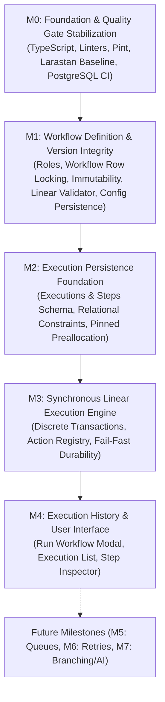

# Atlas — Implementation Roadmap

**Document Version:** 1.1  
**Status:** Approved Implementation Plan  
**Baseline Implementation:** `docs/internal/current-state.md`  
**Architecture Reference:** `docs/internal/architecture.md`  
**Execution Specification:** `docs/internal/linear-execution-spec.md`  

---

## 1. Executive Summary & Purpose

This document translates the verified repository baseline (`current-state.md`), technical architecture (`architecture.md`), and linear execution specification (`linear-execution-spec.md`) into a sequential, actionable engineering roadmap.

The primary objective is to take Atlas from its current baseline—where workflow graph editing and basic version management exist, but quality gates are broken, authorization is unenforced, and execution does not exist—to a fully functional, deterministic, and auditable **Linear Workflow Automation Engine** with user-facing execution history.

### Guiding Engineering Principles
1. **No Code Before Foundation:** Quality gates and CI infrastructure must be green before implementing new features (M0).
2. **Integrity Before Execution:** Graph validation, draft concurrency, role authorization, and canvas configuration persistence must be solved before execution begins (M1).
3. **Schema Before Engine:** Database persistence entities, constraints, and relational integrity must be verified before runtime execution logic is written (M2).
4. **Strict Linearity First:** The initial engine executes strictly unbranched paths ($Trigger \to [Actions] \to End$) synchronously and deterministically, deferring all distributed queues and branching (M3).
5. **Observability Closes the Loop:** Execution history, step inputs/outputs, and error inspection must be surfaced clearly in the user interface (M4).

---

## 2. Milestone Overview & Dependency Graph

### Milestone Summary Matrix

| Milestone | Core Objective | Primary Deliverables | Strict Exclusions |
|---|---|---|---|
| **M0** | Stabilize foundation & restore quality gates | Fix 5 failing gates + configure PostgreSQL CI; establish baseline | New features, schema migrations, domain rewrites |
| **M1** | Establish workflow correctness & data persistence | `WorkflowPolicy`, workflow-row locking, immutability, linear validator, editor config serialization | Execution schema, execution engine runtime |
| **M2** | Establish execution persistence entities | `workflow_executions`, `workflow_execution_steps` tables, constraints, factories | Execution engine logic, action handlers, HTTP runner |
| **M3** | Build synchronous linear execution engine | In-process execution runner, discrete transactions, `action.echo`, `action.transform`, fail-fast pipeline | Queues, workers, background jobs, retries, branching |
| **M4** | Surface execution history & run UI | "Run Workflow" modal, execution history table, per-step payload inspector | Complex canvas animations, live socket streaming |
| **M5–M7** | Future capabilities | Background queues, retries/reapers, conditional branching, AI/OCR | Initial execution engine scope |

---

## 3. Milestone M0: Foundation & Quality Gate Stabilization

### 3.1 Objective
Eliminate existing technical debt across TypeScript, linting, styling, static analysis, and continuous integration to establish a reliable, fully automated quality gate baseline (8 of 8 gates passing) before feature development.

### 3.2 Scope
- Remediate compiler and linter failures across frontend and backend.
- Establish a formal static-analysis baseline for the 76 Larastan Level 7 errors with a controlled burndown plan.
- Configure automated continuous integration with a dedicated PostgreSQL 17 service container.
- Distinguish local violation fixes from ongoing automated CI enforcement.

### 3.3 Dependencies
- None. (Prerequisite for all subsequent milestones).

### 3.4 The Eight Authoritative Quality Gates
The Atlas quality gate suite is defined by eight concrete checks configured in the repository:

| # | Quality Gate | Verification Command | Baseline Status | Required M0 Action |
|---|---|---|---|---|
| **1** | **Backend Test Suite** | `php artisan test` | **PASS** (127 tests) | Maintain passing status against PostgreSQL `atlas_test` (port 5458). |
| **2** | **Frontend Production Build** | `npm run build` | **PASS** (Vite build) | Maintain zero-warning production asset compilation. |
| **3** | **TypeScript Checks** | `npm run types:check` (`tsc --noEmit`) | **FAIL** (TS5103) | Remove unsupported `"ignoreDeprecations": "6.0"` from `tsconfig.json:111`. |
| **4** | **PHP Static Analysis** | `composer run types:check` (`phpstan analyse`) | **FAIL** (76 errors) | Generate baseline file (`phpstan-baseline.neon`); enforce zero new errors. |
| **5** | **PHP Code Style** | `composer run lint:check` (`pint --test`) | **FAIL** (26 files) | Run `vendor/bin/pint` to auto-format and enforce project style rules. |
| **6** | **Frontend Linter** | `npm run lint:check` (`eslint .`) | **FAIL** (7 errors) | Fix synchronous `setState` in `useEffect` in `show.tsx`; fix import ordering. |
| **7** | **Frontend Formatting** | `npm run format:check` (`prettier --check resources/`) | **FAIL** (7 files) | Run `npm run format` (`prettier --write resources/`). |
| **8** | **Continuous Integration** | GitHub Actions (`.github/workflows/tests.yml`) | **UNCONFIGURED** | Add `postgres:17-alpine` service container; enforce all gates in CI. |

### 3.5 Concrete Deliverables

#### 1. Local Code Violation Fixes
- **TypeScript:** Fix TS5103 in `tsconfig.json:111`. Verify `npm run types:check` exits 0 under TypeScript 5.7.
- **Frontend Linter & Formatter:** Remediate 7 ESLint errors in `resources/js/pages/workflows/show.tsx` and `resources/js/pages/workspaces/show.tsx`:
  - Refactor synchronous `setState` inside `useEffect` (React compiler rule `react-hooks/set-state-in-effect`).
  - Correct import order and type-only import syntax.
  - Run Prettier to format all 7 non-compliant frontend files.
- **PHP Code Style:** Execute `vendor/bin/pint` across 26 non-compliant PHP files to satisfy `pint --test`.

#### 2. Larastan Baselining & Controlled Burndown Strategy
- Under Larastan Level 7, the codebase currently generates 76 static analysis errors across models, actions, and controllers (generic collections, missing relationship return types, strict comparisons).
- **The Baselining Plan:**
  1. Generate a formal `phpstan-baseline.neon` file recording exactly the 76 legacy baseline errors.
  2. Include `phpstan-baseline.neon` in `phpstan.neon`.
  3. **Zero New Errors Rule:** Enforce that all new or modified code in M0 and subsequent milestones must pass Larastan Level 7 with zero unbaselined errors (`composer run types:check` exits 0).
  4. **Controlled Burndown Path:** Group the 76 legacy errors by category:
     - Category A: Missing Eloquent relationship return types (e.g. `BelongsTo`, `HasMany`).
     - Category B: Missing generic collection docblocks (`Collection<int, Model>`).
     - Category C: Strict null/boolean comparison mismatches.
     Remediate Category A and B during M0/M1 as touched files are refactored, reducing the baseline without stalling feature velocity or triggering sprawling refactors of Fortify boilerplate.

#### 3. Ongoing CI Pipeline Enforcement
- Local fixes verify current working tree cleanliness; ongoing CI enforcement prevents regressions permanently.
- Update `.github/workflows/tests.yml`:
  - Provision a `postgres:17-alpine` service container on port 5458 with PostgreSQL credentials matching `phpunit.xml`.
  - Add steps to execute all eight quality checks: `php artisan test`, `composer run lint:check`, `composer run types:check`, `npm run types:check`, `npm run lint:check`, `npm run format:check`, and `npm run build`.
  - Block pull request merging and push events on any gate failure.

### 3.6 Acceptance Criteria & Exit Gate
- [ ] `php artisan test` passes 100% of tests against PostgreSQL.
- [ ] `npm run build` succeeds without warnings.
- [ ] `npm run types:check` exits 0.
- [ ] `composer run types:check` (`phpstan`) exits 0 against the approved baseline.
- [ ] `composer run lint:check` (`pint --test`) exits 0.
- [ ] `npm run lint:check` (`eslint .`) exits 0.
- [ ] `npm run format:check` (`prettier --check resources/`) exits 0.
- [ ] GitHub Actions CI workflow successfully runs all quality checks against PostgreSQL and is green on the working branch.

### 3.7 Explicit Exclusions
- No new application features, schema migrations, or API routes.
- No modifications to workflow execution logic or authorization rules.

---

## 4. Milestone M1: Workflow Definition & Version Integrity

### 4.1 Objective
Resolve existing security, concurrency, and serialization flaws in workflow definition management, ensuring that published workflow graphs are strictly linear, immutable, and possess fully persisted node configurations before the execution engine consumes them.

### 4.2 Scope
- Role-based authorization enforcement via policies (`WorkflowPolicy`).
- Synchronized workflow-row locking for draft updates and version publishing.
- Enforced immutability for published and archived version metadata, nodes, and edges.
- Strict linear graph validation ($E = V - 1$, degree constraints, acyclic traversal).
- Remediation of the workflow editor canvas to serialize and persist full node configurations.
- Workspace slug collision handling.

### 4.3 Dependencies
- **M0** (Green quality gates and PostgreSQL CI).

### 4.4 Concrete Deliverables

#### 1. Role-Based Authorization (`WorkflowPolicy`)
- Create `App\Policies\WorkflowPolicy` mapping `WorkspaceRole`:
  - `owner`, `admin`: full management (create, update, publish, delete, execute).
  - `member`: create, update draft, execute.
  - `viewer`: view-only; strictly prohibited from creating, updating, publishing, or executing workflows.
- Update `CreateWorkflowRequest`, `UpdateWorkflowDraftRequest`, and controllers to enforce policy gates.
- Add feature tests verifying that `viewer` receives HTTP 403 on all mutation endpoints.

#### 2. Workflow-Row Concurrency & Locking Strategy
- **The Vulnerability:** `UpdateWorkflowDraft` currently executes inside a transaction but does not lock records, allowing concurrent draft edits to race with `PublishWorkflowVersion` and overwrite definitions during publication.
- **The Required Architectural Guarantee:** Draft updates and version publishing must serialize against the **same parent workflow row** using a consistent locking strategy:
  - In `PublishWorkflowVersion`, the workflow is locked:
    `$workflow = Workflow::query()->whereKey($version->workflow_id)->lockForUpdate()->firstOrFail();`
  - In `UpdateWorkflowDraft`, the action must acquire an identical lock on the parent workflow row within its transaction:
    `$workflow = Workflow::query()->whereKey($workflow->id)->lockForUpdate()->firstOrFail();`
  - Acquiring the lock on the parent `Workflow` row is mandatory; simply locking the draft version row in isolation does **not** solve the race because publishing alters the parent workflow and archives previous versions.
  - Refresh draft version status inside the lock; if `status !== Draft`, throw `ValidationException` (HTTP 422) instead of raw `\LogicException` (HTTP 500).

#### 3. Published & Archived Version Immutability
- **Current Baseline vs. Intended Enforcement:** In the current baseline, non-draft versions are protected only by an incomplete application-level check in `UpdateWorkflowDraft`. Immutability must be formally enforced across all mutation paths.
- **Enforcement Scope:**
  - **Version Metadata:** Prohibit updating attributes (`version_number`, `published_at`, `status`) of a version once published or archived, except for the explicit transition `published -> archived` during publication of a new version.
  - **Workflow Nodes:** Prohibit creating, updating, or deleting `workflow_nodes` belonging to published or archived versions.
  - **Workflow Edges:** Prohibit creating, updating, or deleting `workflow_edges` belonging to published or archived versions.
- Enforce immutability through action guards and model-level constraints, backed by feature tests confirming direct mutation attempts against non-draft versions fail.

#### 4. Strict Linear Graph Validator
- Implement strict linear validation in `ValidateWorkflowGraph` (or dedicated `ValidateLinearWorkflowGraph`):
  - Assert $|V| \ge 2$, exactly 1 Trigger (in-degree 0, out-degree 1), exactly 1 End (in-degree 1, out-degree 0).
  - Assert all Action nodes have in-degree 1 and out-degree 1.
  - Assert $|E| = |V| - 1$.
  - Assert single directed path traversal visiting all $|V|$ nodes without branching, forks, or diamond merges.
  - Direct Trigger $\to$ End ($V=2, E=1$) validated as explicitly legal.

#### 5. Editor Configuration Persistence Remediation (Prerequisite Blocker)
- **Known Limitation:** `resources/js/pages/workflows/show.tsx` strips custom node configuration on save, persisting only `{ label }`.
- **Remediation:** Update canvas serialization and form requests to preserve full `configuration` JSON objects across node creation, editing, and saving.
- Assert that `workflow_nodes.configuration` contains all user-defined action settings upon save.

#### 6. Workspace Slug Collision Handling
- Harden `App\Actions\Workspace\CreateWorkspace` to append incremental numeric suffixes if a generated slug already exists.

### 4.5 Acceptance Criteria & Exit Gate
- [ ] Viewers are rejected with HTTP 403 when attempting to create, update, or publish workflows.
- [ ] Concurrent draft save and publish requests serialize on the parent workflow row, eliminating race conditions.
- [ ] Attempting to modify metadata, nodes, or edges of published/archived versions is completely rejected.
- [ ] Attempting to publish a non-linear graph (branching, forks, cycles, disconnected nodes) returns HTTP 422.
- [ ] Saving a workflow from the web UI canvas preserves node configuration in the database.
- [ ] Workspace creation with duplicate names generates unique slugs.
- [ ] 100% of new unit and feature tests pass against PostgreSQL.

### 4.6 Explicit Exclusions
- No execution tables or execution runtime logic.
- No non-linear graph capabilities (branches, conditions, parallel paths).

---

## 5. Milestone M2: Execution Persistence Foundation

### 5.1 Objective
Establish the relational database schema, Eloquent models, state machine enums, and integrity constraints for workflow executions and steps, without introducing runtime execution logic.

### 5.2 Scope
- Database migrations for `workflow_executions` and `workflow_execution_steps`.
- Model classes, casts, relationships, and status state machines.
- Foreign key cascading (pure cascade deletion for MVP) and indexes.
- Pinned step preallocation logic based on the validated linear order of the pinned published version.
- Persistence test suite verifying relational constraints and idempotency indexing.

### 5.3 Dependencies
- **M0** (Quality gates).
- **M1** (Workflow definition integrity and published immutability).

### 5.4 Concrete Deliverables

#### 1. Database Migrations
- Create `create_workflow_executions_table`:
  - Columns: `id`, `workspace_id`, `workflow_id`, `workflow_version_id`, `status` (`pending`, `running`, `completed`, `failed`), `trigger_type`, `trigger_payload` (JSONB), `idempotency_key` (nullable), `created_by`, `started_at`, `finished_at`, `error` (nullable text/JSONB), timestamps.
  - Constraints: Foreign key `workspace_id` (cascade), `workflow_id` (cascade), `workflow_version_id` (cascade).
  - Partial unique index: `CREATE UNIQUE INDEX uq_executions_idempotency ON workflow_executions (workspace_id, workflow_id, idempotency_key) WHERE idempotency_key IS NOT NULL;`
- Create `create_workflow_execution_steps_table`:
  - Columns: `id`, `workflow_execution_id`, `workflow_version_id`, `node_key`, `node_type`, `step_number`, `attempt` (default 1), `status` (`pending`, `running`, `completed`, `failed`, `skipped`), `input` (JSONB), `output` (JSONB), `error` (JSONB/text), `started_at`, `finished_at`, timestamps.
  - Constraints: Foreign key `workflow_execution_id` (cascade), foreign key `workflow_version_id` (cascade).
  - Unique constraints:
    - `CREATE UNIQUE INDEX uq_execution_step_number ON workflow_execution_steps(workflow_execution_id, step_number);`
    - `CREATE UNIQUE INDEX uq_execution_node_attempt ON workflow_execution_steps(workflow_execution_id, node_key, attempt);`

#### 2. Relational Integrity & Cascade Deletion Policy
- Pinned `workflow_version_id` references `workflow_versions(id)` with `ON DELETE CASCADE`. In alignment with the approved MVP cascade deletion policy, deleting a workflow or workspace cascades cleanly to all associated executions and steps without PostgreSQL constraint conflicts. (Soft deletion and immutable audit retention are deferred to Milestone M6).
- Assert relational consistency across models:
  `workflow.workspace_id == execution.workspace_id` and `version.workflow_id == execution.workflow_id`.
- Composite verification: Every preallocated step's `node_key` must belong to the execution's pinned `workflow_version_id`.

#### 3. Step Preallocation from Pinned Linear Version
- Service method to preallocate all $|V|$ step records in `pending` status upon execution creation:
  - Must read nodes and edges **strictly from the execution's pinned published version**.
  - Must follow the **validated linear execution order** (traversing from Trigger, along single directed edges, to End).
  - Step 1: Trigger node (`node_type = 'trigger'`).
  - Steps $2 \dots |V|-1$: Action nodes (`node_type = 'action'`).
  - Step $|V|$: End node (`node_type = 'end'`).

#### 4. Eloquent Models & Tests
- Models: `WorkflowExecution` and `WorkflowExecutionStep`.
- Enums: `WorkflowExecutionStatus` and `WorkflowExecutionStepStatus`.
- Persistence tests verifying unique indexes, foreign key cascading, and step preallocation order.

### 5.5 Acceptance Criteria & Exit Gate
- [ ] Database migrations execute cleanly up and down on PostgreSQL 17.
- [ ] Deleting a workflow or workspace cascades cleanly to delete associated executions and steps in PostgreSQL.
- [ ] Partial unique index reliably enforces `idempotency_key` uniqueness per `(workspace_id, workflow_id)`.
- [ ] Preallocation logic derives steps strictly from the pinned published version in exact linear topological order.
- [ ] Unique constraints on `step_number` and `(node_key, attempt)` are fully verified by tests.

### 5.6 Explicit Exclusions
- No runtime execution engine or action handlers.
- No HTTP execution endpoints.
- No background workers or queues.

---

## 6. Milestone M3: Synchronous Linear Execution Engine

### 6.1 Objective
Implement the initial synchronous, in-process execution engine strictly adhering to `linear-execution-spec.md`, executing linear workflows from Trigger through Actions to End with deterministic contracts, discrete transaction boundaries, and fail-fast durability.

### 6.2 Scope
- Execution creation with parent workflow row locking (`CreateWorkflowExecutionAction`).
- Trigger payload validation (JSON object, 1 MB limit).
- Action handler interface (`WorkflowActionInterface`) and registry.
- Proof action implementations: `action.echo` and `action.transform`.
- Engine-managed Trigger (Step 1) and End (Step $|V|$) steps.
- Simple Hybrid context propagation (`$input` chaining + `$context['steps'][node_key]`).
- Discrete per-step transaction boundaries (preserving completed step history on failure).
- Downstream step skipping on failure.
- Idempotent request handling with return-existing semantics.

### 6.3 Dependencies
- **M0** (Quality gates).
- **M1** (Linear validation and editor configuration persistence).
- **M2** (Execution and step persistence schema).

### 6.4 Concrete Deliverables

#### 1. Execution Creation & Concurrency Locking
- `CreateWorkflowExecutionAction`:
  - Acquires row lock on parent workflow (`Workflow::query()->whereKey($id)->lockForUpdate()`), serializing against publishing.
  - Resolves active published version; rejects drafts or archived versions with HTTP 422.
  - Validates incoming trigger payload (must be JSON object, max 1 MB).
  - Handles idempotency key: if existing execution found for key in workflow, returns existing execution with `Idempotent-Replay: true`; handles insertion race via unique constraint catch.
  - Atomically inserts execution record (`status = 'pending'`) and preallocates all $|V|$ step records in `pending`.

#### 2. Discrete Transaction Boundaries (Audit Trail Preservation)
> [!IMPORTANT]
> **No Monolithic Transaction:** The entire workflow execution must **never** run inside one long database transaction. If wrapped in a single transaction, any failure at step $k$ rolls back the database, annihilating the audit trail of completed steps $1 \dots k-1$ and preventing failure persistence.

Atlas enforces discrete transaction boundaries:
1. **Boundary 1 — Execution Allocation & Step Preallocation:** Insert execution (`pending`) and all preallocated steps (`pending`). Commit.
2. **Boundary 2 — Step Start:** Update Step $k$ to `status = 'running'`, `input = $stepInput`, `started_at = now()`. (If Step 1, update execution to `running`). Commit.
3. **Boundary 3 — Action Execution:** In-memory execution of PHP action handler outside database transactions.
4. **Boundary 4 — Step Completion:** Update Step $k$ to `status = 'completed'`, `output = $stepOutput`, `finished_at = now()`. Commit.
5. **Boundary 5 — Step Failure & Skipping:** On exception, update Step $k$ to `status = 'failed'`, update remaining steps ($k+1 \dots |V|$) to `status = 'skipped'`, update execution to `status = 'failed'`, `error = $summary`. Commit. Completed steps $1 \dots k-1$ remain durably committed in PostgreSQL.
6. **Boundary 6 — Execution Completion:** After Step $|V|$ (End node) completes, update execution to `status = 'completed'`, `finished_at = now()`. Commit.

#### 3. Core Action Implementations
- `App\Services\Execution\Actions\EchoAction` (`action.echo`):
  - Completely deterministic output without dynamic timestamps.
- `App\Services\Execution\Actions\TransformAction` (`action.transform`):
  - Dot-separated source path lookup (`data_get`).
  - Mapping direction: destination key $\to$ source path.
  - Modes: `project` (mapped keys only) and `merge` (shallow copy with mapped overrides).
  - Default fallbacks via `set_defaults`.

#### 4. Execution API Endpoint
- `POST /workspaces/{workspace}/workflows/{workflow}/executions` endpoint invoking creation and synchronous execution.

### 6.5 Acceptance Criteria & Exit Gate
- [ ] Direct Trigger $\to$ End workflow executes successfully; 2 step records created; status `completed`.
- [ ] Multi-step workflow (Trigger $\to$ Echo $\to$ Transform $\to$ End) executes with exact data propagation; status `completed`.
- [ ] Intermediate action failure marks that step `failed`, subsequent steps `skipped`, execution `failed`; prior completed steps remain intact in PostgreSQL.
- [ ] Submitting duplicate idempotency key returns original execution (HTTP 200 / `Idempotent-Replay: true`) without creating a duplicate run or failing on insertion race.
- [ ] Attempting to execute draft or archived version returns HTTP 422.
- [ ] 100% of acceptance criteria test suites defined in `linear-execution-spec.md` pass against PostgreSQL.

### 6.6 Explicit Exclusions
- No asynchronous queue workers (Horizon, Redis, SQS, RabbitMQ).
- No automatic step retries or backoff.
- No execution cancellation or interactive pause/resume.
- No external HTTP webhook dispatching or third-party SaaS integrations.

---

## 7. Milestone M4: Execution History & User Interface

### 7.1 Objective
Deliver the user interface and observability capabilities allowing workspace members to trigger workflow runs, inspect execution history, view per-step inputs and outputs, and debug failures.

### 7.2 Scope
- "Run Workflow" modal on workflow canvas with JSON payload editor.
- Client-side idempotency key generation per run intent.
- Execution history list view with status badges, runtimes, and filtering.
- Execution detail inspector displaying the linear step pipeline, inputs, outputs, context, and error traces.
- Authorization enforcement in the UI (disabling execution triggers for `viewer` role).

### 7.3 Dependencies
- **M0** (Quality gates).
- **M1** (Role authorization & editor persistence).
- **M2** (Execution persistence models).
- **M3** (Working linear execution engine).

### 7.4 Concrete Deliverables
1. **Frontend "Run Workflow" Modal:**
   - Action button in workflow canvas header: enabled only when active published version exists.
   - Modal allows user to provide JSON trigger input (with JSON syntax validation).
   - Generates unique UUIDv4 `idempotency_key` upon modal submission; disables button with spinner during execution.
2. **Execution History Tab:**
   - Dedicated "Executions" tab on `Workflow/Show` page.
   - Paginated table showing: Execution ID, Status Badge (`completed` green, `failed` red, `running` blue, `pending` yellow), Trigger Type, Duration, Started At, and Triggered By.
3. **Execution Detail Inspector (`Executions/Show`):**
   - Visual linear step progress pipeline showing all preallocated steps in sequence.
   - Clickable step cards displaying:
     - Status badge and duration.
     - Formatted, collapsible JSON tree viewer for step `$input` and `$output`.
     - Formatted exception message and stack trace for `failed` steps.
     - Indication of `skipped` steps due to upstream failure.
4. **Role Enforcement in UI:**
   - Inspect user permissions: hide or disable "Run Workflow" button for `viewer` members.
5. **Inertia Controller Integration:**
   - `WorkflowExecutionController` providing `index` and `show` actions with scoped route bindings.

### 7.5 Acceptance Criteria & Exit Gate
- [ ] Workspace member can trigger a workflow from the UI and see the completed run immediately.
- [ ] Failed runs display exact error message and highlighted failed step in the UI.
- [ ] Completed step inputs and outputs can be inspected in the JSON viewer.
- [ ] Double-clicking "Run" button does not trigger duplicate executions (idempotency key protection verified via UI).
- [ ] Viewers cannot see or activate the "Run Workflow" control.
- [ ] All frontend pages pass ESLint, TypeScript, and Prettier checks.

### 7.6 Explicit Exclusions
- No live WebSocket log streaming (standard Inertia request/response is sufficient for synchronous execution).
- No canvas editing of execution runs (executions are read-only audit records).

---

## 8. Later Milestones (Future Architecture)

The following capabilities are explicitly deferred from the initial linear implementation to maintain delivery focus and avoid premature distributed complexity:

### Milestone M5: Asynchronous Execution & Queue Infrastructure
- Evaluate and introduce asynchronous background processing (e.g. database queue, Redis, or Laravel Horizon), deferring the exact queue driver decision until M5 design.
- Transition `CreateWorkflowExecutionAction` to dispatch asynchronous background jobs.
- Asynchronous polling or Inertia partial reload for active executions.
- Execution timeout handling.

### Milestone M6: Reliability, Retries & Operational Hardening
- Per-action retry policies with exponential backoff and jitter.
- Stale execution reaper (identifying and failing `running` executions whose PHP worker died).
- Execution cancellation tokens and administrative abort endpoints.
- Execution log archiving and data retention policies.
- Soft deletion (`SoftDeletes`) and execution history retention policies (preserving historical runs upon workflow/workspace deletion).

### Milestone M7: Advanced Graph Capabilities & Integrations
- Conditional edge branching (if/else routers, expression conditions).
- Parallel split and join execution synchronization.
- Third-party connector ecosystem (Slack, GitHub, Stripe, Google Workspace).
- Document AI, OCR inference nodes, and multimodal prompt nodes.
- Human-in-the-loop approval workflows with interactive pause and resume.

---

## 9. Implementation Verification & Governance

### 9.1 Milestone Progression Protocol
Before any milestone is marked complete and work begins on the subsequent milestone:
1. All concrete deliverables for that milestone must be merged into the working branch.
2. The full quality gate suite (all 8 checks) must pass cleanly.
3. Specific milestone acceptance criteria tests must pass against PostgreSQL.
4. No milestone may bypass an uncompleted dependency.

### 9.2 Regression Prevention Rules
- Any regression in quality gates (e.g. introducing new Pint style violations or TypeScript errors) immediately blocks subsequent feature work until resolved.
- Database migrations must remain reversible (`php artisan migrate:rollback` verified in CI).
- Pinned execution immutability and tenant isolation must be asserted in all new test suites.
