# Atlas — Linear Execution Specification

**Document Version:** 1.2  
**Status:** Approved Target Specification (Initial Execution Contract)  
**Baseline Implementation:** `docs/internal/current-state.md`  
**Architecture Reference:** `docs/internal/architecture.md`  
**Historical Reference:** `docs/internal/atlas-product-and-architecture.md`  

---

## 1. Purpose and Scope

This document defines the authoritative engineering specification and acceptance contract for the **Initial Workflow Execution Engine** in Atlas (Milestones M2–M4).

### 1.1 Document Purpose
- Define the exact execution lifecycle, data contracts, and persistence models required to execute workflows.
- Guide backend and frontend implementation without premature distributed system complexity.
- Serve as the authoritative testing and acceptance contract for execution functionality.

### 1.2 Boundary Conventions Used in this Specification
Requirements and architectural guarantees throughout this document are labeled with their authoritative classification:
- `[Existing Baseline]`: Behavior, schema, or validation verified as currently implemented in the repository.
- `[Intended Architectural Invariant]`: Architectural invariant agreed in design, pending complete enforcement mechanisms (e.g. published-version immutability).
- `[Approved Execution Contract]`: Concrete technical specifications resolved and approved for implementation.
- `[Open Decision]`: Design alternatives documented for final policy confirmation.

### 1.3 Scope Boundary Summary

| Capability | In Scope (Initial Linear Execution) | Out of Scope (Deferred to Future Milestones) |
|---|---|---|
| **Topology** | Strictly linear: Trigger → zero or more Actions → End | Branching, conditional paths, parallel execution, loops/cycles |
| **Execution Mode** | Synchronous, deterministic, in-process HTTP/CLI execution | Distributed background workers, message queues, Kafka/RabbitMQ |
| **Eligibility** | Currently published version only (`WorkflowVersionStatus::Published`) | Draft versions, archived versions for new runs, unvalidated graphs |
| **Version Pinning** | Execution permanently pinned to exact `workflow_version_id` | Dynamic execution updates when new versions are published |
| **Step Preallocation**| Preallocate all $|V|$ step records (Trigger, Actions, End) at creation | Dynamic just-in-time step discovery |
| **Retries** | No retries; each step executes at most once (`attempt = 1`) | Automatic retry policies, exponential backoff, jitter |
| **Cancellation** | Deferred; execution states do not support runtime cancellation | Interactive abort, timeout reaper, cancellation tokens |
| **Persistence** | Durable execution runs and per-step inputs, outputs, errors | Ephemeral execution, in-memory-only pipelines |
| **Transactions** | Discrete per-step transaction boundaries | Monolithic all-or-nothing execution transaction |
| **Action Catalog** | Minimal deterministic test actions (`Log`/`Echo`, `Transform`) | External HTTP webhooks, 3rd-party SaaS integrations, AI/OCR nodes |
| **Data Propagation**| Simple Hybrid Model (previous output as input, cumulative context) | Complex expression language, arbitrary JSONPath script evaluators |
| **Idempotency** | Partial unique index; existing execution returned on match | Distributed Redis locks, distributed leasing coordination |
| **Fault Tolerance** | Deterministic fail-fast termination with audit trail | Automated retries, dead-letter queues, orphan reaper |

### 1.4 Implementation Prerequisite: Editor Configuration Persistence
> [!WARNING]
> **Known Baseline Limitation / Implementation Prerequisite:**  
> The current workflow editor canvas (`resources/js/pages/workflows/show.tsx`) strips custom node configuration upon save, persisting only `{ label }`.  
> Before the execution engine can consume node definitions, **the workflow editor serialization must be remediated to preserve node configurations and graph metadata through persistence**. The execution engine must read persisted configuration strictly from the pinned, published `workflow_versions` table, never from unsaved canvas state.

---

## 2. Execution Terminology

The following domain definitions govern the execution subsystem:

- **Workflow `[Existing Baseline]`:** The root organizational entity belonging to a single workspace (`workflows` table).
- **Workflow Version `[Existing Baseline]`:** A snapshot of workflow graph structure (`workflow_versions` table) with a lifecycle status (`draft`, `published`, `archived`). *(Published and archived versions are intended to be immutable, but complete enforcement is not yet established in the current baseline)*.
- **Workflow Node `[Existing Baseline]`:** A vertex in the workflow graph (`workflow_nodes` table) with a unique UUID key within the version (`node_key`), a node type (`trigger`, `action`, `end`), configuration JSONB, and canvas position JSONB.
- **Workflow Edge `[Existing Baseline]`:** A directed connection (`workflow_edges` table) between `source_node_key` and `target_node_key` within a specific workflow version.
- **Workflow Execution `[Approved Execution Contract]`:** A persisted instance record representing a single end-to-end run of a workflow against an exact pinned version.
- **Execution Step `[Approved Execution Contract]`:** A persisted record tracking the invocation, state transitions, input data, output data, error trace, and timestamps of a single node within an execution. Every node in the linear sequence—including Trigger and End—has a dedicated step record.
- **Linear Sequence `[Intended Architectural Invariant]`:** An ordered, unbranched sequence of nodes traversed from entry to exit:
  $$[v_{\text{trigger}}, v_{\text{action}_1}, v_{\text{action}_2}, \dots, v_{\text{action}_n}, v_{\text{end}}] \quad (n \ge 0)$$
- **Step Input (`$input`) `[Approved Execution Contract]`:** The direct data payload delivered to a step. Always a valid JSON object representing the immediately preceding step's output (or the incoming trigger payload for Step 1).
- **Execution Context (`$context`) `[Approved Execution Contract]`:** The read-only cumulative data dictionary made available to actions, containing immutable trigger input and prior step outputs indexed collision-free by node UUID.
- **Idempotency Key `[Approved Execution Contract]`:** An optional client- or caller-supplied key preventing duplicate execution runs. When the same key is submitted for the same workflow, the engine returns the existing execution rather than creating a duplicate.

---

## 3. Workflow Graph Contract

### 3.1 Mathematical Definition `[Intended Architectural Invariant]`
A valid linear workflow graph in Atlas is a finite, directed, connected, unbranched acyclic graph $G = (V, E)$ satisfying:

1. **Vertex Set:**
   $$V = \{ v_{\text{trigger}} \} \cup \{ v_{\text{action}_1}, \dots, v_{\text{action}_n} \} \cup \{ v_{\text{end}} \}$$
   where $n \ge 0$ is the count of intermediate action nodes.
2. **Total Node Count:**
   $$|V| = n + 2 \ge 2$$
3. **Edge Set:**
   $$E = \{ (v_0, v_1), (v_1, v_2), \dots, (v_m, v_{m+1}) \}$$
   where $v_0 = v_{\text{trigger}}$, $v_{m+1} = v_{\text{end}}$, and $m = n$.
4. **Total Edge Count:**
   $$|E| = |V| - 1 = n + 1 \ge 1$$
5. **Path Uniqueness:** There exists exactly one directed simple path from $v_{\text{trigger}}$ to $v_{\text{end}}$ of length $|E|$ containing all vertices in $V$.

### 3.2 Direct Trigger-to-End Workflow `[Approved Execution Contract]`
A workflow with zero intermediate actions ($n = 0$) is explicitly **valid** and supported:
- $|V| = 2$ nodes: Exactly one Trigger node and exactly one End node.
- $|E| = 1$ edge: A single directed edge $(v_{\text{trigger}}, v_{\text{end}})$.
- Total execution steps: Exactly 2 pre-allocated step records (Step 1: Trigger, Step 2: End).
- Behavior: The trigger receives input, and the end node immediately consumes that input as the final workflow output.

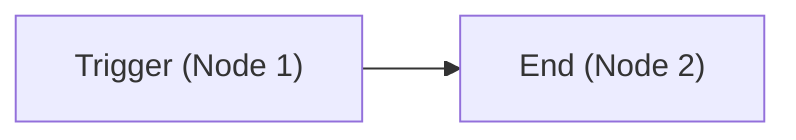

### 3.3 Linear Workflow with Actions `[Approved Execution Contract]`
When $n \ge 1$ actions exist, each action sits in strict serial succession:

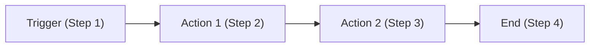

---

## 4. Node Types and Responsibilities

Atlas recognizes three node types defined in `App\Enums\WorkflowNodeType` `[Existing Baseline]`:

### 4.1 Trigger Node (`WorkflowNodeType::Trigger`)
- **Cardinality:** Exactly one per workflow version.
- **Responsibility:** Ingests external input payload (manual UI payload, incoming webhook, or system event). Initiates execution flow.
- **Execution Role:** Executes as **Step 1** of every execution run. It is a lightweight engine-managed step (not a user-defined action). It consumes the raw incoming trigger payload, validates that it is a JSON object within size limits, stores it as Step 1 output, and initializes the execution context.
- **Degrees:** In-degree = 0, Out-degree = 1.

### 4.2 Action Node (`WorkflowNodeType::Action`)
- **Cardinality:** Zero or more per workflow version ($n \ge 0$).
- **Responsibility:** Executes an isolated, deterministic computational or transformation step.
- **Execution Role:** Executes as intermediate steps ($2 \dots |V|-1$). Consumes `$input` (the previous step's output) and has access to cumulative `$context`. Executes its registered PHP action handler, and produces a single output JSON object.
- **Degrees:** In-degree = 1, Out-degree = 1.

### 4.3 End Node (`WorkflowNodeType::End`)
- **Cardinality:** Exactly one per workflow version.
- **Responsibility:** Formally marks execution completion and captures the final workflow output.
- **Execution Role:** Executes as the terminal step ($|V|$). It is a lightweight engine-managed step that consumes the output of Step $|V|-1$ as its input, seals the workflow execution output, and marks the execution as `completed`.
- **Degrees:** In-degree = 1, Out-degree = 0.

---

## 5. Edge Rules

All edges in `workflow_edges` must adhere to strict structural constraints `[Intended Architectural Invariant]`:

| Node Type | Allowed In-Degree | Allowed Out-Degree | Prohibited Edge Scenarios |
|---|---|---|---|
| **Trigger** | **0** | **1** | Incoming edges, multiple outgoing edges, target of any edge |
| **Action** | **1** | **1** | In-degree $\ne$ 1, Out-degree $\ne$ 1, multiple sources, branching targets |
| **End** | **1** | **0** | Outgoing edges, multiple incoming edges, source of any edge |

### Explicit Invariants
1. **No Self-Loops:** An edge where `source_node_key == target_node_key` is strictly forbidden. *(Enforced in `ValidateWorkflowGraph` `[Existing Baseline]`)*.
2. **No Duplicate Edges:** Multiple edges between the same source and target are forbidden. *(Enforced by composite unique index `workflow_edges (workflow_version_id, source_node_key, target_node_key)` `[Existing Baseline]`)*.
3. **No Parallel Edges:** No two edges may share the same source node or the same target node.
4. **No Conditional Edges in Linear Scope:** The `condition` column on `workflow_edges` must be null or empty; branching on condition is deferred.
5. **No Disconnected Nodes:** Every node must be connected. Isolated nodes with in-degree 0 and out-degree 0 are invalid.

---

## 6. Graph Validation Requirements

### 6.1 Baseline General Validator vs. Required Linear Validator
- **Existing Baseline Validator (`ValidateWorkflowGraph`):** Checks general connected DAG properties (1 Trigger, 1 End, self-loop rejection, Kahn's algorithm cycle check, BFS reachability). It does **not** enforce linear degree constraints and permits branches, forks, and diamond merges.
- **Required Linear Validator:** A new/updated validation action dedicated to enforcing the strict linear contract before publishing and before execution.

### 6.2 Required Linear Validation Engine `[Approved Execution Contract]`
Prior to publishing or executing workflows in the linear engine, the validation suite must enforce the complete linear graph contract:

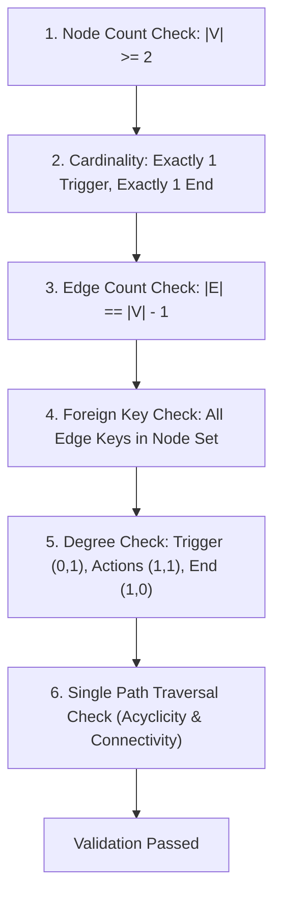

### 6.3 Detailed Validation Steps and Error Messages

1. **Node Population Check:**
   - `$nodes->count() >= 2`.
   - Rejection error: `"A linear workflow requires at least one Trigger node and one End node."`
2. **Trigger Cardinality Check:**
   - Exactly 1 node with `type = 'trigger'`.
   - Rejection error: `"A workflow must contain exactly one Trigger node."`
3. **End Cardinality Check:**
   - Exactly 1 node with `type = 'end'`.
   - Rejection error: `"A workflow must contain exactly one End node."`
4. **Edge Count Equality Check:**
   - `$edges->count() === ($nodes->count() - 1)`.
   - Rejection error: `"A linear workflow with N nodes must contain exactly N - 1 edges."`
5. **Degree Constraint Verification:**
   - Compute in-degree and out-degree maps for all nodes.
   - Trigger: `inDegree === 0` and `outDegree === 1`.
     - Rejection: `"The Trigger node must have zero incoming connections and exactly one outgoing connection."`
   - End: `inDegree === 1` and `outDegree === 0`.
     - Rejection: `"The End node must have exactly one incoming connection and zero outgoing connections."`
   - Every Action: `inDegree === 1` and `outDegree === 1`.
     - Rejection: `"Each Action node must have exactly one incoming connection and one outgoing connection."`
6. **Sequential Traversal Verification:**
   - Begin at `trigger_node_key`.
   - Traverse the single outgoing edge to the next node.
   - Repeat traversal until reaching `end_node_key` or encountering a visited node.
   - Assert: Count of traversed nodes equals `$nodes->count()`.
   - Assert: Final visited node is the End node.
   - Rejection: `"Workflow graph contains disconnected nodes, cycles, or unreachable paths."`
7. **Rejection Contract:** Any validation failure throws `Illuminate\Validation\ValidationException` with structured validation messages (HTTP 422).

---

## 7. Workflow Publication and Execution Eligibility

### 7.1 Execution Eligibility Matrix `[Approved Execution Contract]`

| Version Status | Can Be Edited? | Can Be Published? | Can Start New Execution? | Existing In-Flight / Past Runs |
|---|---|---|---|---|
| **`draft`** | Yes | Yes (if valid) | **NO (HTTP 422)** | Cannot exist (drafts cannot run). |
| **`published`** | No | No (already published) | **YES** | Runs normally against this pinned version. |
| **`archived`** | No | No (historical) | **NO (HTTP 422)** | **Continues normally** using this pinned version. |

### 7.2 Strict Version Execution Rules `[Approved Execution Contract]`
1. **Targeting the Active Published Version Only:**
   - New executions can **only** be initiated against the currently `published` version of a workflow.
   - An execution request (`POST /workspaces/{workspace}/workflows/{workflow}/executions`) does not accept a version parameter in the payload; it resolves the active published version within a locked transaction.
2. **Drafts Cannot Execute:**
   - Attempting to execute a draft version is strictly prohibited (returns HTTP 422). Draft graphs are unstable and subject to concurrent mutation.
3. **Archived Versions Cannot Start New Executions:**
   - An archived version is an obsolete historical snapshot. Initiating a new execution against an archived version is strictly prohibited (returns HTTP 422: `"Cannot start a new execution against an archived workflow version. Only the active published version can be executed."`).
   - This eliminates version selection ambiguity for users and automated callers.
4. **Existing Executions Persist Through Archival:**
   - When a new draft is published, the previous published version transitions to `archived`.
   - Any execution already created or in flight that was pinned to that version **continues executing against that pinned version** without interruption or modification.
   - Past execution history remains permanently auditable and readable.

### 7.3 Publication / Execution Concurrency Serialization `[Approved Execution Contract]`
To prevent race conditions between publishing a new version and initiating an execution, execution creation and workflow publication must serialize against the workflow using a consistent locking strategy:

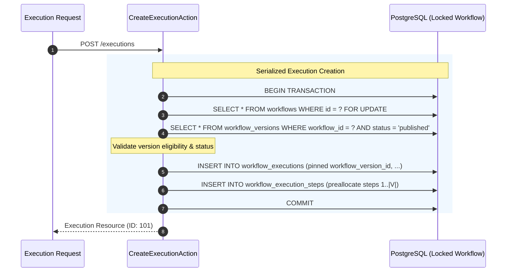

**Architectural Guarantee:**
- During execution creation, the engine acquires a lock on the parent workflow (`Workflow::query()->whereKey($workflow->id)->lockForUpdate()`), matching the lock acquired in `PublishWorkflowVersion`.
- Within the locked transaction:
  1. The currently published version is resolved.
  2. Eligibility is verified (`status === Published`).
  3. The `workflow_version_id` is pinned.
  4. The execution and all preallocated steps are inserted atomically.
- This prevents publication races from producing an execution against an ambiguous, in-flight, or concurrently archived version.

---

## 8. Execution Version Pinning

### 8.1 The Pinning Guarantee `[Intended Architectural Invariant]`
When an execution is created, the execution engine permanently records the exact foreign key `workflow_version_id` on the `workflow_executions` table:

$$\text{Execution} \xrightarrow{\quad \text{pins} \quad} \text{WorkflowVersion}(\text{id}, \text{version\_number}, \text{status} = \text{'published'})$$

### 8.2 Operational Guarantees
- **Draft Modifications:** A user modifying the workflow draft while an execution is running has zero impact on the execution. The execution reads nodes and edges exclusively from its pinned `workflow_version_id`.
- **Subsequent Publications:** When a user publishes Version $N+1$, Version $N$ becomes archived. Executions pinned to Version $N$ are completely unaffected.
- **Audit Stability:** Step records store the exact `workflow_version_id` and `node_key` values. Combining Version Pinning with Published Version Immutability (M1) guarantees an audit record that never degrades or changes over time.

---

## 9. Execution Lifecycle

### 9.1 Initial Execution States `[Approved Execution Contract]`
The initial execution engine defines four valid states:
- `pending`: Execution created in database, trigger payload recorded, all $|V|$ steps preallocated; ready to run.
- `running`: Traversal has commenced; at least one step is in progress; `started_at` is set.
- `completed`: Terminal state. Every preallocated node in the sequence (Trigger $\to$ Actions $\to$ End) executed with status `completed`. `finished_at` is set.
- `failed`: Terminal state. An action or node threw an unhandled exception or returned an error payload. Execution halted immediately. `finished_at` and `error` are set.

*(Note: Runtime cancellation is deferred. While a `cancelled` value may exist in schema enums for future compatibility, it is unused in the initial linear engine).*

### 9.2 Valid Execution State Transitions `[Approved Execution Contract]`

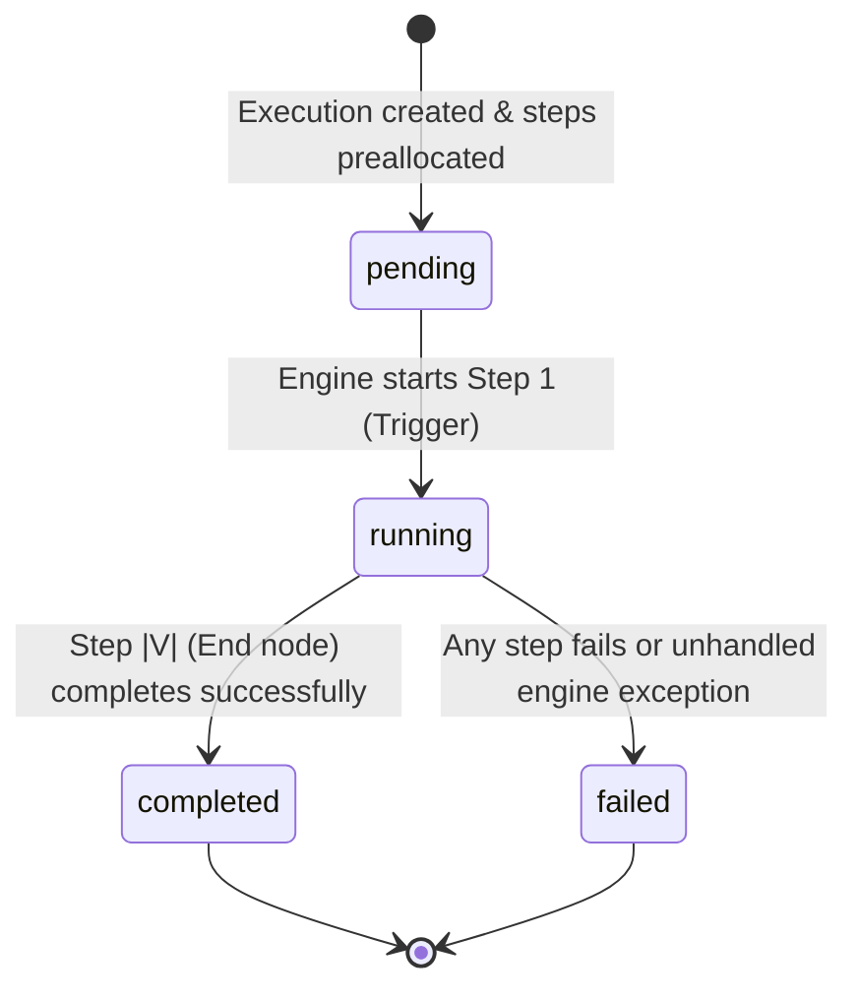

| Source State | Target State | Triggering Event |
|---|---|---|
| `[*]` | `pending` | Execution record inserted in database within creation transaction. |
| `pending` | `running` | Traversal begins; Step 1 (Trigger) transitions to `running`. |
| `running` | `completed` | Final step ($|V|$, End node) finishes with status `completed`. |
| `running` | `failed` | Any step transitions to `failed`, or engine encounters an unhandled fatal error. |

### 9.3 Terminal State Immutability `[Intended Architectural Invariant]`
Once a `workflow_executions` record transitions into a terminal status (`completed`, `failed`), its status and execution outcome attributes become permanently read-only:
- No transitions out of terminal states are permitted.
- `finished_at`, `status`, and `error` cannot be modified.

---

## 10. Step Lifecycle

### 10.1 Step Preallocation Model `[Approved Execution Contract]`
When a `workflow_executions` record is created, the execution engine **immediately preallocates and inserts all $|V|$ step records** in `workflow_execution_steps` within the creation transaction:

1. Step records are assigned sequential `step_number` values ($1, 2, \dots, |V|$) matching the linear topological path.
2. Every node in the pinned version receives a corresponding step record:
   - **Step 1:** The Trigger node (`node_type = 'trigger'`).
   - **Steps $2 \dots |V|-1$:** The intermediate Action nodes (`node_type = 'action'`).
   - **Step $|V|$:** The End node (`node_type = 'end'`).
3. Initial state for all preallocated step records is `pending`.

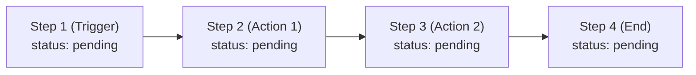

### 10.2 Initial Step States and Valid Transitions `[Approved Execution Contract]`

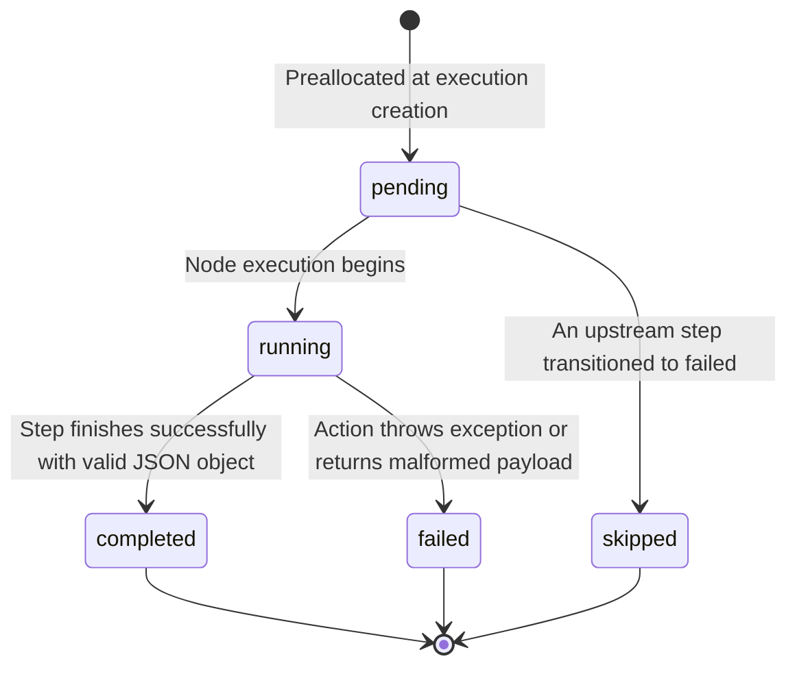

| Source State | Target State | Triggering Event |
|---|---|---|
| `[*]` | `pending` | Preallocated at execution creation. |
| `pending` | `running` | Node handler begins active processing. `started_at = now()`. |
| `running` | `completed` | Handler returns a valid JSON object within payload limits. `output` stored, `finished_at = now()`. |
| `running` | `failed` | Handler throws an exception, raises an error, or returns non-JSON/oversized payload. `error` stored, `finished_at = now()`. |
| `pending` | `skipped` | Any preceding step failed; engine aborts pipeline and marks downstream steps skipped with `finished_at = now()`. |

### 10.3 No Retries In Initial Engine `[Approved Execution Contract]`
- The initial linear engine has **no retries**.
- Each step is executed at most once per execution (`attempt = 1`).
- If a step fails, it transitions immediately to `failed`, and execution terminates.

---

## 11. Action Execution Contract

### 11.1 The Action Handler Contract `[Approved Execution Contract]`
All user-configured action node executors must implement the `WorkflowActionInterface`:

```php
namespace App\Services\Execution\Contracts;

interface WorkflowActionInterface
{
    /**
     * Execute the deterministic action logic.
     *
     * @param  array<string, mixed>  $input          Direct output JSON object of immediately preceding step
     * @param  array<string, mixed>  $configuration  Persisted node configuration from WorkflowNode
     * @param  array<string, mixed>  $context        Read-only cumulative execution context
     * @return array<string, mixed>                  Result JSON object to pass to the next step
     *
     * @throws \App\Services\Execution\Exceptions\ActionExecutionException
     */
    public function handle(array $input, array $configuration, array $context): array;

    /**
     * Validate node configuration prior to execution or publishing.
     *
     * @param  array<string, mixed>  $configuration
     * @return array<string, string>  Array of validation error messages (empty if valid)
     */
    public function validateConfiguration(array $configuration): array;
}
```

### 11.2 Trigger and End Node Handlers `[Approved Execution Contract]`
Trigger and End nodes are **lightweight engine-managed steps**, not user-defined actions:
- **Trigger Handler (Step 1):**
  - `$input`: Validated incoming trigger JSON object.
  - `$output`: Trigger payload, stored as Step 1 output.
  - Context initialization: Sets `$context['trigger'] = $output` and `$context['steps'][$triggerNodeKey] = $output`.
- **End Handler (Step $|V|$):**
  - `$input`: Output JSON object of Step $|V|-1$.
  - `$output`: Final execution output (identical to `$input`).
  - Seals execution state as `completed`.

### 11.3 Minimal Initial Action Registry `[Approved Execution Contract]`
Atlas specifies two initial core actions to prove the engine deterministically without external network dependencies:

#### Action 1: Log / Echo Action (`action.echo`)
- **Purpose:** Diagnostic and auditing node. Records messages and passes input data through to output.
- **Determinism Rule:** Action output must be **completely deterministic**. Identical input and configuration must produce identical output.
  - **No dynamic timestamps** in action output. Execution and step timestamps belong in database persistence records (`started_at`, `finished_at`), not in the action's payload.
  - Logging is a side effect (written to system logs or persisted step record) and must not alter the returned payload.
- **Configuration Schema:**
  ```json
  {
    "message": "Processing invoice payload",
    "log_level": "info",
    "include_input": true
  }
  ```
- **Input Contract:** Any valid JSON object (`array<string, mixed>`).
- **Context Access:** Can inspect `$context['trigger']` or prior steps.
- **Output Contract:**
  ```json
  {
    "message": "Processing invoice payload",
    "log_level": "info",
    "echo": { ... }
  }
  ```
  *(If `include_input` is false, `"echo"` key is omitted).*
- **Validation Rules:** `log_level` must be one of `debug`, `info`, `warning`, `error`. `message` string must not exceed 1000 characters.
- **Failure Behavior:** Throws `ActionExecutionException` if configuration is invalid or payload exceeds 1 MB.

#### Action 2: Simple Data Transformation Action (`action.transform`)
- **Purpose:** Deterministic payload manipulation: key projection, renaming, and literal field assignments.
- **Mapping Direction:** Destination key $\to$ Source path:
  `"mappings": { "<destination_key>": "<dot.separated.source.path>" }`
- **Dot-Separated Path Evaluation:** Source paths are navigated using dot notation (e.g. `"user.email"`, `"order.items.0.sku"` via Laravel `data_get($input, $path)`).
- **Missing Source Keys & `set_defaults` Behavior:**
  - If a source path is missing from `$input` or resolves to `null`:
    - If `set_defaults[destination_key]` is defined, the default value is assigned.
    - If not defined in `set_defaults`, the destination key is **omitted** from the output.
  - Any keys in `set_defaults` that do not appear in `mappings` are added as literal fields to the output.
- **Operation Modes:**
  - **`project` Mode:** Output contains **only** destination keys produced by `mappings` and literal fields from `set_defaults`. All unmapped keys from `$input` are discarded.
  - **`merge` Mode:** Output begins with a full shallow copy of `$input`. Mapped destination keys and default fields are merged on top.
  - **Overwrite Rule:** In `merge` mode, mapped destination keys explicitly overwrite matching top-level keys in `$input`.
- **Configuration Schema:**
  ```json
  {
    "mode": "project",
    "mappings": {
      "customer_email": "user.email",
      "order_id": "checkout.id"
    },
    "set_defaults": {
      "source": "atlas_linear_engine"
    }
  }
  ```
- **Input Contract:** Any valid JSON object (`array<string, mixed>`).
- **Output Contract:** Deterministic JSON object containing mapped and defaulted keys.
- **Validation Rules:** `mode` must be `'project'` or `'merge'`. `mappings` must be an associative array of non-empty strings. `set_defaults` (optional) must be a JSON object.
- **Simplicity Constraint:** No expression languages, dynamic scripts, or arbitrary evaluators.

---

## 12. Input and Output Data Contract

### 12.1 Strict JSON Object Data Contract `[Approved Execution Contract]`
To prevent ambiguous array/scalar payload behavior, Atlas enforces a strict data contract:

1. **Trigger Payload:** Must be a valid JSON object (`{}` or key-value map; never a scalar string/number, boolean, null, or JSON indexed array `[]`).
2. **Action Input & Output:** Must be JSON objects (`array<string, mixed>`).
3. **Empty JSON Objects:** `{}` is explicitly valid as input or output.
4. **Invalid Payloads:** Non-object payloads (e.g. `"raw string"`, `42`, `true`, `[1, 2, 3]`) are rejected immediately.
5. **Pre-execution Rejection:** Invalid JSON in trigger input is rejected at the API boundary before execution creation (HTTP 422).

### 12.2 Simple Hybrid Data Propagation Model `[Approved Execution Contract]`

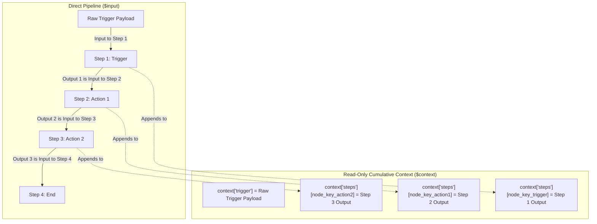

### 12.3 Rules of the Hybrid Model
1. **Direct Input `$input`:** Each step receives the immediately preceding step's output as `$input`.
   - For Step 1 (Trigger), `$input` is the incoming trigger payload.
   - For Step $k$ ($k > 1$), `$input` is Step $k-1$'s `$output`.
2. **Cumulative Context `$context`:**
   - Actions receive `$context` as a third read-only parameter: `handle($input, $configuration, $context)`.
   - Actions **cannot mutate `$context`**; an action can only return its own `$output` dictionary.
3. **Collision-Free Accumulation Rule:**
   - To eliminate name collision and overwrite vulnerabilities without requiring complex scoping rules, context data is keyed strictly by immutable system identifiers:
     ```php
     $context = [
         'trigger' => $initialTriggerPayload,
         'steps' => [
             // Keyed strictly by node_key (UUID string)
             'a1b2c3d4-0000-0000-0000-000000000001' => [ ...output... ],
             'a1b2c3d4-0000-0000-0000-000000000002' => [ ...output... ],
         ],
         'steps_by_index' => [
             // Keyed by 1-based step sequence number
             1 => [ ...output... ],
             2 => [ ...output... ],
         ],
     ];
     ```
   - Because `node_key` is a UUID unique within the workflow version (enforced by DB unique index `(workflow_version_id, node_key)`), **key collisions are mathematically impossible**.
   - No overwrites can occur during linear execution.
4. **No Complex Expression Engine:**
   - In this initial linear engine, `$context` is accessed via direct PHP array keys. Complex template parsing, arbitrary expression evaluators, and dynamic JSONPath scripting languages are **explicitly out of scope**.
5. **Exact Application of the 1 MB Payload Limit:**
   The 1 MB (1,048,576 bytes) serialized JSON limit applies to:
   - **Incoming Trigger Payload:** Validated before creating the execution record.
   - **Step Output Payloads:** Validated upon completion of each step before committing.
   - **Cumulative Execution Context:** Engine asserts total accumulated context does not exceed 10 MB. Exceeding limits halts execution with `PayloadTooLargeException`.

---

## 13. Persistence Requirements

### 13.1 Existing Tables Summary `[Existing Baseline]`
Atlas currently maintains:
- `workspaces`: Tenant root.
- `workspace_memberships`: User memberships and roles (`owner`, `admin`, `member`, `viewer`).
- `workflows`: Workflow root (scoped to `workspace_id`).
- `workflow_versions`: Version snapshots with `status` (`draft`, `published`, `archived`).
- `workflow_nodes`: Graph vertices with `node_key` (UUID), `type`, `configuration` (JSONB), `position` (JSONB).
- `workflow_edges`: Directed edges with composite foreign keys to `workflow_nodes(workflow_version_id, node_key)`.

### 13.2 Proposed Execution Persistence Entities `[Approved Execution Contract]`
The execution engine introduces two new database tables:

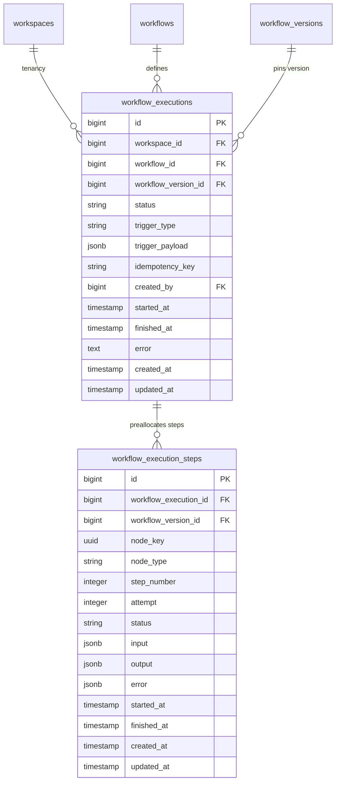

#### Table: `workflow_executions`
- `id`: Bigint primary key.
- `workspace_id`: Foreign key to `workspaces(id)` on delete cascade `[Tenancy Root]`.
- `workflow_id`: Foreign key to `workflows(id)` on delete cascade.
- `workflow_version_id`: Foreign key to `workflow_versions(id)` on delete cascade.
- `status`: String(30) (`pending`, `running`, `completed`, `failed`, `cancelled`).
- `trigger_type`: String(50) (e.g. `manual`, `webhook`, `scheduled`).
- `trigger_payload`: JSONB (raw input provided when starting execution).
- `idempotency_key`: String(100), nullable.
- `created_by`: Foreign key to `users(id)`, nullable.
- `started_at`: Timestamp with time zone, nullable.
- `finished_at`: Timestamp with time zone, nullable.
- `error`: Text or JSONB, nullable.
- `created_at`, `updated_at`: Timestamps.

**Indexes & Constraints:**
- `CREATE INDEX idx_executions_workspace_workflow ON workflow_executions(workspace_id, workflow_id);`
- `CREATE INDEX idx_executions_version ON workflow_executions(workflow_version_id);`
- `CREATE INDEX idx_executions_status ON workflow_executions(status);`
- Partial unique index for idempotency:
  `CREATE UNIQUE INDEX uq_executions_idempotency ON workflow_executions(workspace_id, workflow_id, idempotency_key) WHERE idempotency_key IS NOT NULL;`

#### Table: `workflow_execution_steps`
- `id`: Bigint primary key.
- `workflow_execution_id`: Foreign key to `workflow_executions(id)` on delete cascade.
- `workflow_version_id`: Foreign key to `workflow_versions(id)` on delete cascade.
- `node_key`: UUID referencing `workflow_nodes(node_key)`.
- `node_type`: String(30) (`trigger`, `action`, `end`).
- `step_number`: Integer (1-based sequence: 1 for Trigger, 2 for first Action, etc.).
- `attempt`: Integer default 1.
- `status`: String(30) (`pending`, `running`, `completed`, `failed`, `skipped`).
- `input`: JSONB, nullable.
- `output`: JSONB, nullable.
- `error`: JSONB or Text, nullable.
- `started_at`: Timestamp with time zone, nullable.
- `finished_at`: Timestamp with time zone, nullable.
- `created_at`, `updated_at`: Timestamps.

**Persistence Integrity Constraints `[Approved Execution Contract]`:**
1. **Unique Step Number:** Each step within an execution has a unique sequence number:
   `CREATE UNIQUE INDEX uq_execution_step_number ON workflow_execution_steps(workflow_execution_id, step_number);`
2. **Single Node Execution per Run:** In the initial no-retry model, a node executes at most once per execution:
   `CREATE UNIQUE INDEX uq_execution_node_attempt ON workflow_execution_steps(workflow_execution_id, node_key, attempt);`
3. **Pinned Version Node Membership:** Every step's `node_key` must belong to the execution's pinned `workflow_version_id`.
4. **Relational Consistency:**
   - `workflow.workspace_id == workflow_executions.workspace_id`
   - `workflow_versions.workflow_id == workflow_executions.workflow_id`
5. **Cascade Deletion Policy (MVP):** Foreign keys to `workspaces`, `workflows`, and `workflow_versions` enforce `ON DELETE CASCADE`. Deleting a workspace or workflow cascades to purge all associated versions, executions, and execution steps cleanly without constraint conflicts. Execution history is not retained after its parent workflow or workspace is deleted in the MVP. (Execution history retention, audit protection, and soft deletion are deferred to Milestone M6).

---

## 14. Execution Ordering

### 14.1 Path Derivation Algorithm `[Intended Architectural Invariant]`
Because a valid linear graph has exactly one entry node (Trigger), exactly one outgoing edge per node (except End), and zero branches, the execution sequence is deterministically resolved using pointer traversal:

```text
Algorithm: ResolveLinearExecutionOrder(version)
Input: Validated WorkflowVersion with Nodes and Edges
Output: Ordered list of nodes [v_0, v_1, ..., v_{|V|-1}]

1. Find node T where T.type == 'trigger'.
2. Initialize ordered_nodes = [T].
3. Let current_key = T.node_key.
4. While current_key != End.node_key:
     Find edge e in Edges where e.source_node_key == current_key.
     Let target_node = Nodes.find(e.target_node_key).
     ordered_nodes.append(target_node).
     current_key = target_node.node_key.
5. Return ordered_nodes.
```

### 14.2 Strict Sequential Step Progression
Steps execute strictly one at a time:
- Step $k+1$ is never started until Step $k$ has committed with `status = 'completed'`.
- If Step $k$ fails, Step $k+1$ is never initiated.

---

## 15. Failure Handling and Interruption

The execution engine adheres to deterministic fail-fast behavior `[Approved Execution Contract]`:

### 15.1 Failure Scenarios and Engine Behavior

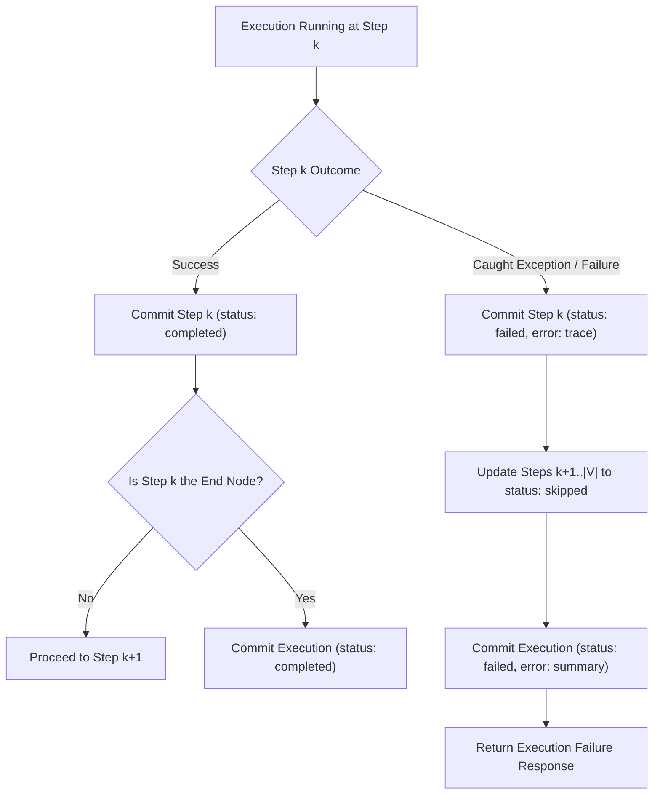

#### Scenario 1: Caught Application or Action Exception
- The action logic raises an exception, returns an error payload, or exceeds payload limits.
- The engine catches the exception.
- Step $k$ is committed as `status = 'failed'` with structured error data (`class`, `message`, `code`, `trace`) and `finished_at = now()`.
- Remaining preallocated steps ($k+1 \dots |V|$) are updated from `pending` to `skipped` with `finished_at = now()`.
- The execution record is committed as `status = 'failed'`, recording error summary and `finished_at = now()`.
- The engine returns an appropriate HTTP response (e.g. HTTP 200 with failed execution resource, or HTTP 422).

#### Scenario 2: Action Produces Malformed Output
- If the action returns non-object data, non-JSON-serializable data, or violates the 1 MB payload limit.
- Treated identically to Scenario 1: Step $k$ marked `failed`, remaining steps marked `skipped`, execution marked `failed`.

#### Scenario 3: Abrupt Process Termination / Crash
- If the server process dies abruptly mid-execution (e.g. OS SIGKILL, hardware failure, fatal uncatchable out-of-memory error).
- Step $k$ and the execution may remain in `running` status in the database.
- The HTTP connection may terminate abruptly without any response.
- *(Detection and cleanup of orphaned `running` executions via heartbeat checks or stale reapers is deferred to background worker milestone M4).*

#### Scenario 4: Step Fails After Prior Steps Succeeded
- **Durability Guarantee:** Completed step records ($1 \dots k-1$) and their output payloads **remain committed in PostgreSQL**.
- The execution engine **never** rolls back or erases the history of successfully completed steps upon a downstream failure.

---

## 16. Transaction Boundaries

> [!IMPORTANT]
> **No Monolithic Transaction:** The entire workflow execution must **never** be wrapped in a single database transaction. Wrapping an entire execution in one transaction causes any failure at step $k$ to roll back the database, annihilating all step audit history and preventing the recording of the failure state.

Atlas mandates **Discrete Transaction Boundaries** `[Approved Execution Contract]`:

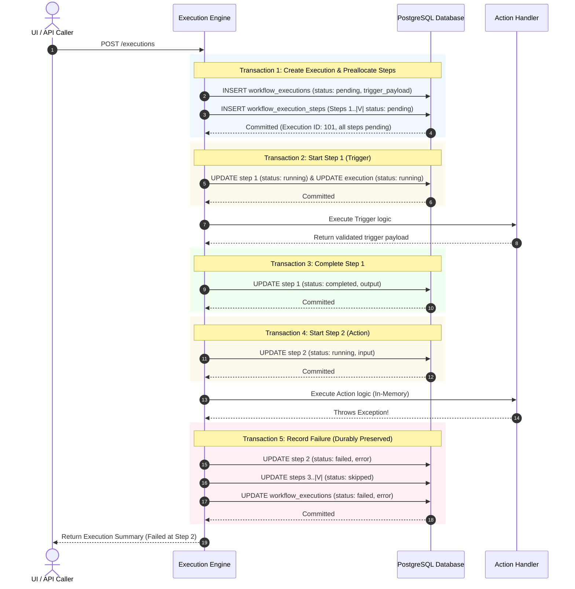

### Discrete Transaction Boundaries
1. **Boundary 1 — Execution Allocation & Step Preallocation:**
   - In a single atomic transaction:
     - Lock workflow (`FOR UPDATE`).
     - Resolve active published version.
     - Insert `workflow_executions` record with `status = 'pending'`, pin `workflow_version_id`, store `trigger_payload`.
     - Insert all $|V|$ preallocated `workflow_execution_steps` records with `status = 'pending'`, `step_number` ($1 \dots |V|$), `node_key`, and `node_type`.
   - Commit.
2. **Boundary 2 — Step Start:**
   - Atomic update: Set `workflow_execution_steps` row for Step $k$ to `status = 'running'`, `input = $stepInput`, `started_at = now()`.
   - If Step 1: Also update `workflow_executions` to `status = 'running'`, `started_at = now()`.
   - Commit.
3. **Boundary 3 — Action Execution (In-Memory):**
   - User-defined action logic runs outside database transactions.
4. **Boundary 4 — Step Completion:**
   - Atomic update: Set `workflow_execution_steps` row for Step $k$ to `status = 'completed'`, `output = $stepOutput`, `finished_at = now()`.
   - Commit.
5. **Boundary 5 — Step Failure & Skipping:**
   - Atomic transaction:
     - Set Step $k$ to `status = 'failed'`, `error = $errorData`, `finished_at = now()`.
     - Set remaining steps ($k+1 \dots |V|$) to `status = 'skipped'`, `finished_at = now()`.
     - Set `workflow_executions` to `status = 'failed'`, `error = $errorSummary`, `finished_at = now()`.
   - Commit.
6. **Boundary 6 — Execution Completion:**
   - After Step $|V|$ (End node) completes, update `workflow_executions` with `status = 'completed'` and `finished_at = now()`.
   - Commit.

---

## 17. Idempotency and Duplicate Execution Contract

### 17.1 Duplicate Execution Scenarios
- User double-clicking "Run Workflow" in the web UI.
- Network timeouts prompting client retries before HTTP response reception.
- External webhook retry mechanisms (e.g., Stripe webhooks).

### 17.2 Idempotency Contract & Concurrency Guarantees `[Approved Execution Contract]`
1. **Client-Generated Key:** The frontend or API client generates an `idempotency_key` (UUIDv4 string) for each logical run request (e.g. upon opening the run dialog).
2. **Database Constraint:**
   ```sql
   CREATE UNIQUE INDEX uq_executions_idempotency
   ON workflow_executions (workspace_id, workflow_id, idempotency_key)
   WHERE idempotency_key IS NOT NULL;
   ```
3. **Race Condition Resolution (First-Write-Wins):**
   - The first request to successfully insert into `workflow_executions` wins and proceeds with execution.
   - If simultaneous duplicate requests race to insert the same key:
     - The request that loses the insertion race encounters a unique constraint violation on `uq_executions_idempotency` (PostgreSQL error 23505).
     - The engine catches the constraint violation and **queries and returns the existing execution record** instead of returning a 500 error.
4. **Return-Existing Semantics:**
   - **Same Workflow + Same Key:** Reusing the same key returns the original execution record (with HTTP 200 OK and header `Idempotent-Replay: true`), **even if the incoming payload differs**. The original execution payload and state are preserved unchanged.
   - **Different Workflow + Same Key:** Scoped strictly by `(workspace_id, workflow_id)`. The same key submitted for two distinct workflows executes independently.
   - **No Key Supplied:** Execution proceeds normally without deduplication protection (`idempotency_key` is stored as `null`).
5. **Supplementary UI Debouncing:** Button debouncing and progress spinners in the web UI are supplementary user-experience enhancements; the database unique constraint is the primary idempotency guarantee.

---

## 18. Authorization and Tenant Isolation

### 18.1 Multi-Tenancy Principles `[Existing Baseline]`
All execution operations strictly enforce Atlas tenancy boundaries:
- Execution routes are nested under the tenant workspace:
  `POST /workspaces/{workspace}/workflows/{workflow}/executions`
- The `EnsureWorkspaceAccess` middleware validates that the authenticated user belongs to `{workspace}`.
- Scoped route binding ensures `{workflow}` belongs to `$workspace->workflows()`.
- Controllers and actions derive `workspace_id` **strictly from the route-resolved workspace model**. Client-supplied `workspace_id` parameters in request bodies are ignored and prohibited.

### 18.2 Role Permissions for Execution `[Intended Architectural Invariant]`
In Milestone M1, `WorkflowPolicy` will govern workflow capabilities based on `WorkspaceRole`:
- `owner`, `admin`, `member`: Authorized to trigger workflow executions (`can('execute', $workflow)` returns `true`).
- `viewer`: Read-only member. **Unauthorized** to trigger workflow executions (`can('execute', $workflow)` returns `false`, resulting in HTTP 403 Forbidden). Viewers are permitted only to inspect execution history (`can('view', $execution)`).

---

## 19. API and UI Integration Boundaries

### 19.1 HTTP API Routes `[Approved Execution Contract]`

```text
POST   /workspaces/{workspace}/workflows/{workflow}/executions
       -> Triggers a new execution against the active published version.
       -> Headers: Idempotency-Key (optional)
       -> Payload: { "trigger_payload": { ... }, "idempotency_key": "..." }
       -> Status: HTTP 201 Created (new run) OR HTTP 200 OK (idempotent replay)
       -> Response: Execution Resource with steps array.

GET    /workspaces/{workspace}/workflows/{workflow}/executions
       -> Returns paginated history of executions for this workflow.
       -> Query filters: ?status=completed|failed&per_page=20

GET    /workspaces/{workspace}/workflows/{workflow}/executions/{execution}
       -> Returns full execution detail: execution record, all preallocated step
          records (pending, running, completed, failed, skipped), inputs, outputs,
          error messages, and elapsed runtimes.
```

### 19.2 UI Integration Boundaries `[Approved Execution Contract]`
1. **Workflow Canvas Page:**
   - "Run Workflow" action button in the canvas header.
   - Disabled if workflow has no published version (`workflow.published_version === null`).
   - Clicking opens a slide-over modal allowing input of initial trigger JSON payload.
2. **Executions Tab:**
   - Dedicated tab on Workflow Show page displaying execution history table:
   - Columns: Execution ID, Status Badge (`completed` green, `failed` red, `running` blue, `pending` yellow), Trigger Type, Steps Completed, Started At, Duration.
3. **Execution Detail Inspector:**
   - Visual execution flow visualization mirroring the linear nodes.
   - Because all steps are preallocated, the UI displays the entire planned pipeline immediately:
     - Completed steps: Green with output inspector.
     - Running step: Blue with active spinner.
     - Failed step: Red with formatted exception trace.
     - Skipped steps: Muted gray indicating halt due to upstream failure.
     - Pending steps: Gray indicating waiting.

---

## 20. Testing and Acceptance Criteria

The execution engine implementation will be verified against the following formal acceptance tests:

### Test Suite 1: Linear Graph Validation
- `test_validator_accepts_direct_trigger_to_end_graph`: $V=2, E=1$.
- `test_validator_accepts_linear_graph_with_actions`: $V=4, E=3$ (Trigger $\to$ Act1 $\to$ Act2 $\to$ End).
- `test_validator_rejects_branching_out_degree_from_action`: Action with 2 outgoing edges fails with 422.
- `test_validator_rejects_merging_in_degree_to_action`: Action with 2 incoming edges fails with 422.
- `test_validator_rejects_disconnected_nodes`: Total $E \ne V - 1$ fails with 422.
- `test_validator_rejects_trigger_with_incoming_edges`: Trigger in-degree $>0$ fails with 422.
- `test_validator_rejects_end_node_with_outgoing_edges`: End out-degree $>0$ fails with 422.

### Test Suite 2: Execution Engine Flow and Step Preallocation
- `test_executes_direct_trigger_to_end_workflow`:
  - Execution completes successfully.
  - Exactly 2 preallocated step records created (Trigger as Step 1, End as Step 2).
  - Final output matches trigger input.
- `test_executes_multi_step_linear_workflow`:
  - Workflow: Trigger $\to$ Log $\to$ Transform $\to$ End.
  - Exactly 4 step records preallocated in `pending`.
  - All 4 steps transition `pending` $\to$ `running` $\to$ `completed`.
  - Step 3 output matches expected transformation.
  - Execution status is `completed`, `finished_at` populated.

### Test Suite 3: Failure Isolation, Skipping, and Durability
- `test_action_failure_halts_execution_and_marks_downstream_skipped`:
  - Workflow: Trigger $\to$ Step 2 (Success) $\to$ Step 3 (Throws Exception) $\to$ Step 4 (End).
  - Step 1 and Step 2 remain `completed` with full output preserved.
  - Step 3 is `failed` with serialized error details.
  - Step 4 transitions from `pending` to `skipped`.
  - Execution status is `failed`.

### Test Suite 4: Version Pinning and Immutability
- `test_execution_pins_published_version_independent_of_new_drafts`:
  - Create execution against Published V1.
  - Modify Draft V2 (add nodes/edges) and publish V2.
  - Re-fetch execution: pinned `workflow_version_id` still references V1; steps match V1 node keys.
- `test_cannot_execute_archived_workflow_version`:
  - Attempting to start execution against an archived version fails with HTTP 422.

### Test Suite 5: Idempotency Protection
- `test_duplicate_idempotency_key_returns_existing_execution`:
  - Submit execution with key `key-123` $\to$ creates Execution 101.
  - Submit identical request with `key-123` $\to$ returns Execution 101 with `Idempotent-Replay: true` header without creating a new record.
- `test_duplicate_key_with_different_payload_returns_original_execution`:
  - Payload difference is ignored; original execution returned.
- `test_same_idempotency_key_allowed_on_different_workflows`:
  - Allowed and creates separate executions.

### Test Suite 6: Security, Tenancy, and Roles
- `test_user_cannot_execute_workflow_in_foreign_workspace`: Returns HTTP 403.
- `test_viewer_role_cannot_trigger_workflow_execution`: Returns HTTP 403.
- `test_cannot_execute_draft_version`: Returns HTTP 422.

---

## 21. Deferred Capabilities

To preserve developer velocity and prevent premature distributed complexity, the following features are **strictly deferred** from the initial linear engine:

1. **Non-Linear Graph Topologies:** Branching, if/else conditions, switch-case routers, parallel execution splits, joins, and loops/cycles.
2. **Distributed Queue Workers:** Asynchronous background job queues (Laravel Horizon, Redis, SQS, RabbitMQ, Kafka). Initial engine runs synchronously in-process.
3. **Automated Retry Policies:** Exponential backoff, jittered retries, and automatic retry attempts for failed actions.
4. **Execution Cancellation:** Runtime abort, cancellation tokens, timeout reapers.
5. **Human-in-the-Loop:** Approval nodes, form inputs during pause, interactive resume tokens.
6. **AI / OCR Node Types:** Multi-modal AI inferences, document OCR extraction, prompt generation nodes.
7. **External Third-Party Ecosystem:** Salesforce, Slack, GitHub, Jira, and Google Workspace integration connectors.

---

## 22. Resolved Decisions & Open Policies

### 22.1 Resolved Engineering Decisions
1. **Data Propagation: Simple Hybrid Model (Approved):**
   - Direct output chaining via `$input` combined with collision-free `$context['trigger']` and `$context['steps'][node_key]`.
   - Actions receive both but can only return their own output dictionary. No complex expression engine.
2. **Step Preallocation with Engine-Managed Trigger and End Steps (Approved):**
   - All $|V|$ steps preallocated at execution creation. Step 1 is Trigger; Step $|V|$ is End.
   - Preallocated steps transition to `skipped` upon upstream failure.
3. **Execution Eligibility: Active Published Version Only (Approved):**
   - New runs execute only the currently published version. Drafts and archived versions cannot start new executions.
   - In-flight/past runs continue using their pinned version even after it is archived.
4. **Idempotency: Return-Existing Semantics (Approved):**
   - Same workflow + same key returns existing execution. Insertion races resolved safely via DB constraint.

### 22.2 Resolved Architectural Decision: Cascade Deletion Policy (MVP)
- **Decision:** Atlas adopts a **Pure Cascade Deletion Policy** for the MVP (Milestones M0–M4).
- **Behavior:** Deleting a workspace or workflow permanently cascades to delete all associated versions, executions, and execution steps. Execution history is **not** retained after its parent workflow or workspace is deleted.
- **Foreign Key Consistency:** To prevent PostgreSQL cascade conflicts (such as "diamond cascade" constraint failures), foreign keys from `workflow_executions` and `workflow_execution_steps` to `workflow_versions` enforce `ON DELETE CASCADE` in alignment with parent workflow and workspace cascading.
- **Deferred to Milestone M6:** Soft deletion (`SoftDeletes`), audit retention policies, and enterprise deletion safeguards (preventing hard deletion of historical execution runs) are explicitly deferred to Milestone M6 (Reliability, Retries & Operational Hardening).
